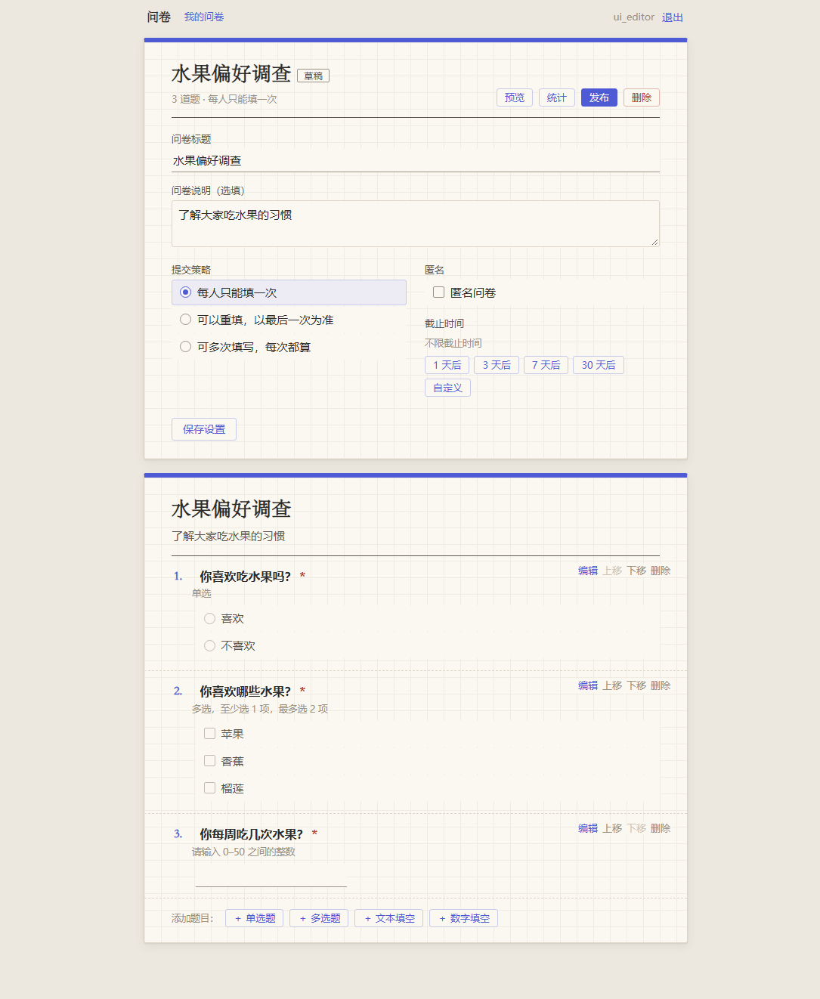
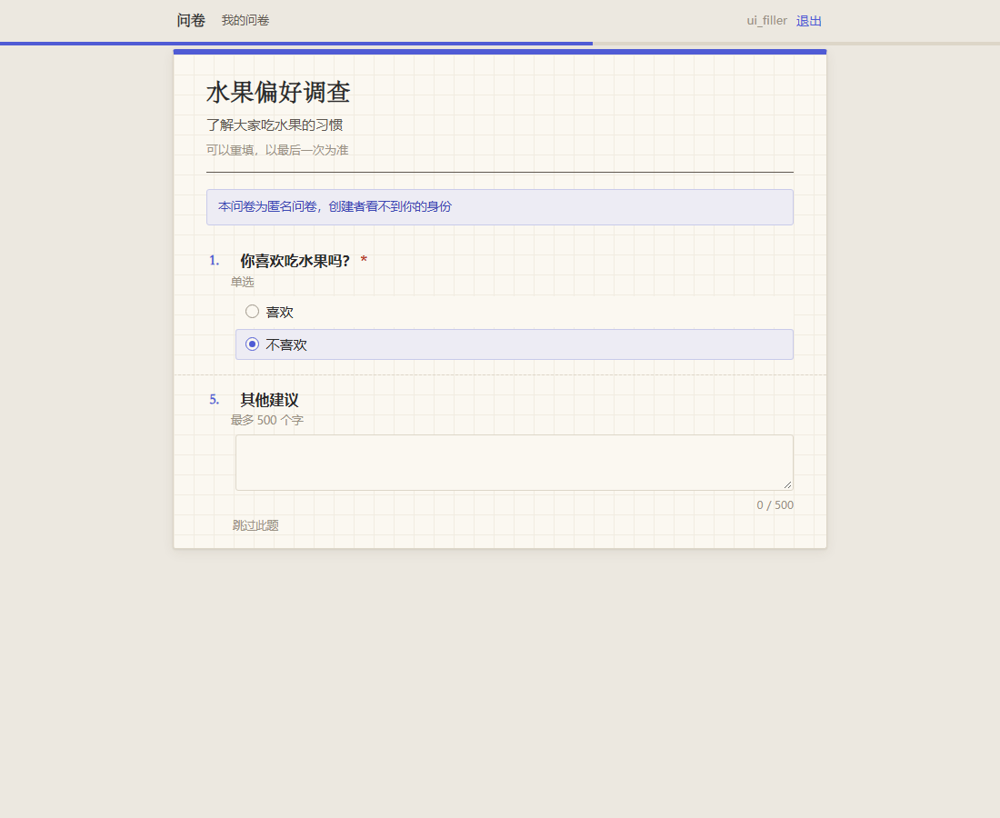
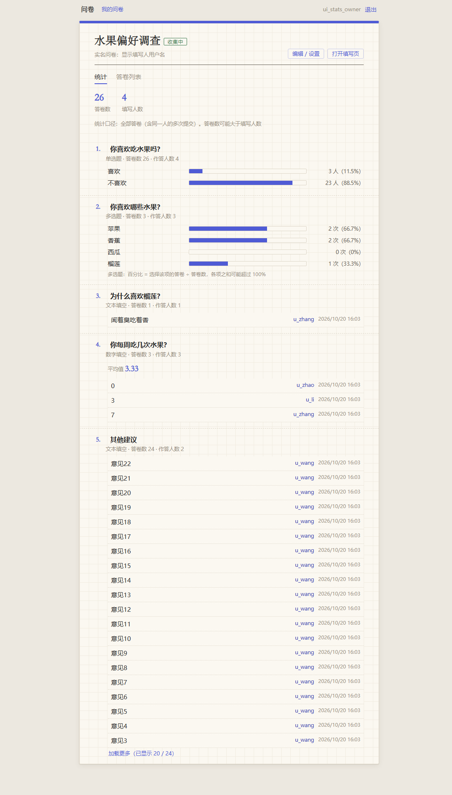
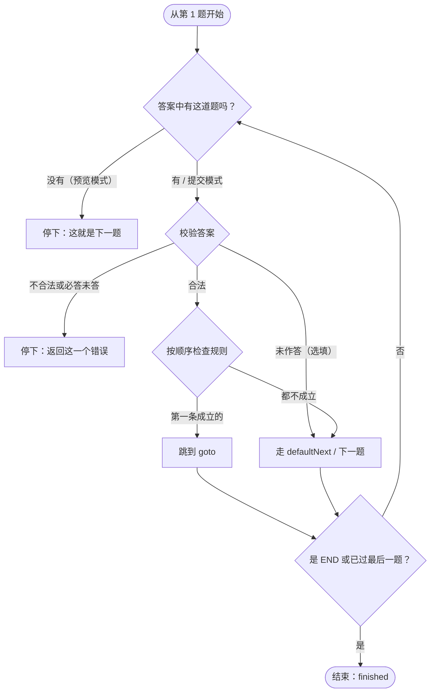

# 基于 MongoDB 的在线问卷系统

一个简化版的在线问卷系统（类似问卷星 / Google Forms）：注册用户创建问卷，设置题目、校验规则和跳转规则，发布后通过链接 `/survey/<shortCode>` 分发；其他用户登录后填写，创建者查看实时统计。所有数据存储在 MongoDB 中。

> 课程项目第一阶段。
> - GitHub 仓库：`（推送后填写）`
> - 线上示例问卷：`（部署后填写，见“十、示例问卷”）`

## 目录

- [一、项目简介](#一项目简介)
- [二、快速开始](#二快速开始)
- [三、部署到 Linux 服务器（阿里云）](#三部署到-linux-服务器阿里云)
- [四、技术栈与版本](#四技术栈与版本)
- [五、项目结构](#五项目结构)
- [六、数据库设计](#六数据库设计)
- [七、API 说明](#七api-说明)
- [八、关键逻辑说明](#八关键逻辑说明)
- [九、测试](#九测试)
- [十、示例问卷](#十示例问卷)
- [十一、文档索引与可扩展性](#十一文档索引与可扩展性)

---

## 一、项目简介

| 功能 | 说明 |
|---|---|
| 账号 | 注册、登录（JWT），密码用 bcrypt 哈希；登录后只能看到自己创建的问卷 |
| 问卷管理 | 创建（标题、说明、是否匿名、提交策略、截止时间）、我的问卷列表、发布、关闭、删除草稿；每份问卷有 `/survey/<shortCode>` 链接 |
| 题型 | 单选（选项、必答）；多选（至少 / 最多 / 必须选几项）；文本填空（最少 / 最多字数）；数字填空（最小值、最大值、是否整数） |
| 跳转 | 按单选、多选、数字的答案跳到后面的题或结束问卷；规则存在问卷数据中，用下拉框设置，保存时检查合法性 |
| 填写 | 填写前需登录；逐题展开，由后端计算下一题；不合法时提示错误；**提交时后端重新计算跳转路径并校验**；支持多人同时填写、匿名、多次填写（三种提交策略） |
| 统计 | 单选各选项人数与作答人数；多选各选项被选次数；填空列出全部内容，数字题给出平均值；整份问卷统计与单题统计；聚合管道实时计算；匿名问卷不返回填写人 |

| 编辑问卷 | 填写问卷（选“不喜欢”跳到第 5 题） | 统计结果 |
|---|---|---|
|  |  |  |

---

## 二、快速开始

### 1. 环境要求

| 软件 | 版本 | 说明 |
|---|---|---|
| Python | 3.11 及以上 | 本项目在 3.14.2 上开发和测试 |
| MongoDB | 5.0 及以上 | 本项目在 8.3.11 上开发和测试；统计中 `$lookup` 同时使用 `localField` 与 `pipeline` 需要 5.0 以上 |
| Node.js | 22 及以上（可选） | 只有界面测试和前端纯函数测试需要；没有时这些测试自动跳过 |
| Chrome 或 Edge | 任意较新版本（可选） | 只有界面测试需要 |

### 2. 安装依赖

```bash
git clone <仓库地址> && cd <项目目录>
python -m venv .venv
.venv\Scripts\activate            # Windows（PowerShell / cmd）
# source .venv/bin/activate       # Mac / Linux
pip install -r requirements.txt
```

### 3. 启动 MongoDB

**Windows（默认方式，开发时使用）**

首次准备（只需一次）：

1. 从 [MongoDB 官网](https://www.mongodb.com/try/download/community) 安装 MongoDB Community Server 和 mongosh（安装时不必勾选 “Install MongoD as a Service”）。
2. 创建数据目录和日志目录：

   ```powershell
   mkdir C:\data\db, C:\data\log
   ```

3. 创建配置文件 `C:\data\mongod.cfg`（只监听本机）：

   ```yaml
   storage:
     dbPath: C:\data\db
   systemLog:
     destination: file
     path: C:\data\log\mongod.log
     logAppend: true
   net:
     port: 27017
     bindIp: 127.0.0.1
   ```

**每次开发或运行测试前，双击 [`scripts/start_mongo.bat`](scripts/start_mongo.bat)，并保持它的窗口开着。**

- 窗口里不会滚动输出，日志写在 `C:\data\log\mongod.log`，这是正常的；按 `Ctrl+C` 停止。
- 若窗口提示 “MongoDB has stopped”，最常见的原因是已经有一个 MongoDB 在运行。
- 配置文件不在默认位置时：`scripts\start_mongo.bat D:\path\to\mongod.cfg`。
- 不用脚本时也可以直接运行：`mongod --config C:\data\mongod.cfg`。
- 验证：`mongosh --eval "db.runCommand({ping:1})"` 输出 `{ ok: 1 }`。

<details>
<summary>可选：在 Windows 上注册为系统服务（开机自动启动）</summary>

注册后就不要再运行 `start_mongo.bat`（二者使用同一端口和数据目录）。**以管理员身份**打开 PowerShell（开始菜单搜索 PowerShell → 右键 → 以管理员身份运行），执行（路径中的 `8.3` 换成实际安装的版本）：

```powershell
& "C:\Program Files\MongoDB\Server\8.3\bin\mongod.exe" --config "C:\data\mongod.cfg" --install
net start MongoDB
```

| 操作 | 命令（管理员 PowerShell） |
|---|---|
| 启动 / 停止 | `net start MongoDB` / `net stop MongoDB` |
| 查看状态 | `sc.exe query MongoDB` |
| 卸载服务（不删除数据） | `net stop MongoDB` 后 `sc.exe delete MongoDB` |

</details>

**Mac（Homebrew）**

```bash
brew tap mongodb/brew
brew install mongodb-community mongosh
brew services start mongodb-community   # 后台服务；或手动：mongod --dbpath ~/data/db（先 mkdir -p ~/data/db）
```

**Linux**：见[三、部署到 Linux 服务器](#三部署到-linux-服务器阿里云)。

### 4. 配置 `.env`

```bash
copy .env.example .env      # Windows；Mac / Linux：cp .env.example .env
```

| 变量 | 作用 | 本地示例 |
|---|---|---|
| `MONGO_URI` | MongoDB 连接串 | `mongodb://127.0.0.1:27017` |
| `MONGO_DB_NAME` | 数据库名（测试会自动改用 `survey_test`，不影响这里的数据） | `survey_dev` |
| `JWT_SECRET` | 登录令牌签名密钥，**至少 32 个字符**；`.env.example` 中的示例值会被拒绝。不满足时程序拒绝启动并提示生成命令 | 用下面的命令生成 |
| `JWT_EXPIRE_MINUTES` | 登录有效期（分钟） | `1440` |
| `PUBLIC_BASE_URL` | 对外访问地址，用于生成问卷链接 `<地址>/survey/<shortCode>`，结尾不加 `/` | `http://127.0.0.1:8000` |
| `BCRYPT_ROUNDS` | 可选，bcrypt 强度，默认 12（测试中自动设为 4） | 不设置 |

```bash
python -c "import secrets; print(secrets.token_urlsafe(48))"   # 生成 JWT_SECRET
```

`MONGO_URI`、`JWT_SECRET`、`PUBLIC_BASE_URL` 在代码中没有默认值，必须在 `.env` 或环境变量中提供（避免把本机地址或示例密钥带到线上）。

### 5. 初始化数据库（可选）

启动服务时会自动创建集合、`$jsonSchema` 校验规则和索引；也可以手动执行（可重复执行，不影响已有数据）：

```bash
python -m scripts.init_db
```

### 6. 启动服务

```bash
uvicorn app.main:app --reload
```

浏览器打开 **http://127.0.0.1:8000**（会进入登录页）。接口文档：http://127.0.0.1:8000/docs 。健康检查：`/api/health` 返回 `{"status":"ok","database":"ok"}`。

> **本地访问请用 `127.0.0.1`，不要用 `localhost`。** Windows 会把 `localhost` 先解析为 IPv6 地址 `::1`，而 uvicorn 默认只监听 IPv4 的 `127.0.0.1`，每个请求要先等 IPv6 连接失败再回退（实测 `localhost` 每次约 2 秒，`127.0.0.1` 约 0.002 秒）。部署到 Linux 服务器时使用服务器的域名或 IP，不受影响。

### 7. 生成示例问卷

```bash
python -m scripts.seed_demo
```

输出问卷链接和账号，详见[十、示例问卷](#十示例问卷)。

### 8. 运行测试

```bash
pytest                                                      # 全部测试（含界面测试）
pytest -m "not ui"                                          # 只跑后端测试（不需要 Node.js 和 Chrome）
pytest --cov=app --cov=scripts --cov-report=term-missing    # 代码覆盖率
```

测试使用独立数据库（`survey_test`、`survey_ui_test`），不会影响开发数据；运行前需先启动 MongoDB。详见[九、测试](#九测试)。

---

## 三、部署到 Linux 服务器（阿里云）

以 **Ubuntu 24.04**（自带 Python 3.12）为例。以下命令在服务器上执行。

**1. 安装 MongoDB 并确认只监听本机**

```bash
sudo apt-get install -y gnupg curl
curl -fsSL https://www.mongodb.org/static/pgp/server-8.0.asc | sudo gpg -o /usr/share/keyrings/mongodb-server-8.0.gpg --dearmor
echo "deb [ arch=amd64,arm64 signed-by=/usr/share/keyrings/mongodb-server-8.0.gpg ] https://repo.mongodb.org/apt/ubuntu noble/mongodb-org/8.0 multiverse" \
  | sudo tee /etc/apt/sources.list.d/mongodb-org-8.0.list
sudo apt-get update && sudo apt-get install -y mongodb-org
sudo systemctl enable --now mongod
grep -A2 "^net:" /etc/mongod.conf      # 应为 bindIp: 127.0.0.1（默认值，不要改成 0.0.0.0）
```

> **安全要求：MongoDB 只监听本机（`bindIp: 127.0.0.1`），不要在阿里云安全组中开放 27017 端口。** 应用和数据库在同一台服务器上，通过 `127.0.0.1` 访问即可；对外开放数据库端口会让任何人都能尝试连接。

**2. 获取代码、安装依赖**

```bash
sudo apt-get install -y python3-venv git
git clone <仓库地址> /opt/survey && cd /opt/survey
python3 -m venv .venv && .venv/bin/pip install -r requirements.txt
```

**3. 配置 `.env`（必须重新生成 `JWT_SECRET`）**

```bash
cp .env.example .env
.venv/bin/python -c "import secrets; print(secrets.token_urlsafe(48))"   # 复制输出作为 JWT_SECRET
nano .env
```

```ini
MONGO_URI=mongodb://127.0.0.1:27017
MONGO_DB_NAME=survey
JWT_SECRET=<上面生成的随机字符串>
JWT_EXPIRE_MINUTES=1440
PUBLIC_BASE_URL=http://<服务器公网 IP 或域名>:8000
```

> **安全要求：部署时必须重新生成 `JWT_SECRET`**，不要沿用本地开发的密钥。知道密钥的人可以伪造任何用户的登录令牌。程序会拒绝 `.env.example` 中的示例值和少于 32 个字符的密钥（启动失败并提示生成命令；报错信息不回显密钥）。

**4. 用 systemd 运行服务**

创建 `/etc/systemd/system/survey.service`：

```ini
[Unit]
Description=Online survey system
After=network.target mongod.service

[Service]
WorkingDirectory=/opt/survey
ExecStart=/opt/survey/.venv/bin/uvicorn app.main:app --host 0.0.0.0 --port 8000
Restart=always
User=www-data

[Install]
WantedBy=multi-user.target
```

```bash
sudo chown -R www-data:www-data /opt/survey
sudo systemctl daemon-reload && sudo systemctl enable --now survey
curl http://127.0.0.1:8000/api/health       # {"status":"ok","database":"ok"}
```

**5. 安全组**：在阿里云控制台的安全组中**只开放 8000 端口**（入方向 TCP 8000），**不开放 27017**。

**6. 生成示例问卷（更换创建者密码）**

```bash
cd /opt/survey && sudo -u www-data .venv/bin/python -m scripts.seed_demo --owner-password '<只有你知道的密码>'
```

输出中的链接即为线上示例问卷地址。报告中只写填写人账号，不写创建者密码。

**更新代码**：`git pull && .venv/bin/pip install -r requirements.txt && sudo systemctl restart survey`。

---

## 四、技术栈与版本

**前端**：原生 HTML + CSS + JavaScript（ES 模块），由后端静态托管；**不使用任何前端框架、CDN 或外部字体**（部署在阿里云，国内访问外部资源不稳定）。

**后端与数据库**

| 组件 | 版本 | 用途 |
|---|---|---|
| Python | 3.14.2（要求 3.11+） | 开发语言 |
| FastAPI | 0.147.0 | Web 框架 |
| Uvicorn | 0.54.0 | ASGI 服务器 |
| PyMongo | 4.19.0 | MongoDB 驱动 |
| Pydantic / pydantic-settings | 2.14.1 / 2.16.0 | 请求响应模型、读取配置 |
| bcrypt | 5.0.0 | 密码哈希 |
| PyJWT | 2.15.1 | 登录令牌 |
| python-dotenv | 1.2.4 | 读取 `.env` |
| MongoDB | 8.3.11（要求 5.0+） | 数据库 |

**测试**

| 组件 | 版本 | 用途 |
|---|---|---|
| pytest | 9.1.1 | 测试框架 |
| httpx2 | 2.14.0 | FastAPI TestClient 的 HTTP 客户端 |
| pytest-cov / coverage | 7.1.0 / 7.16.2 | 代码覆盖率 |
| Node.js | 24.14.0（要求 22+，可选） | 界面测试驱动、前端纯函数测试 |
| Chrome | 155（可选） | 界面测试（无界面模式） |

全部 Python 依赖及版本见 [`requirements.txt`](requirements.txt)。**没有使用任何现成的问卷系统框架或库**（如 SurveyJS、xiaoju-survey）：题型、校验、跳转、统计均为本项目实现。

---

## 五、项目结构

```
app/                        后端
├── main.py                 应用入口：挂载路由、静态资源，启动时初始化集合与索引
├── config.py               读取 .env 配置
├── db.py                   MongoDB 连接、集合名
├── db_schema.py            三个集合的 $jsonSchema 校验规则与索引（设计文档第 5 节）
├── errors.py               统一错误格式 {code, message, errors}
├── security.py             bcrypt、JWT、当前用户
├── routers/                接口层：auth、surveys、questions、fill、stats、meta、pages（前端页面）
├── schemas/                请求与响应模型
├── services/               业务流程：auth、surveys、questions、fill、stats
├── logic/                  纯函数（不访问数据库，可单独测试）
│   ├── operators.py        运算符表：每种题型的运算符、值格式、判断方法（唯一来源）
│   ├── question_rules.py   单道题设置的检查
│   ├── survey_check.py     整份问卷的跳转规则检查与警告
│   ├── validation.py       答案校验与规范化
│   ├── jump.py             答题路径计算
│   └── survey_state.py     问卷状态规则表
├── stats/pipelines.py      统计聚合管道（只构造，不执行）
└── repositories/           数据库读写：users、surveys、responses
static/                     前端：login、surveys、edit、fill、stats 页面；css/style.css；js/
scripts/                    init_db.py 初始化数据库；seed_demo.py 示例数据；start_mongo.bat
tests/                      pytest 测试；tests/ui/ 界面测试（无界面 Chrome）；tests/js/ 前端纯函数测试
docs/                       设计文档、测试用例、AI 使用日志、完成清单、需求原文、报告素材
```

**后端分层**：`routers`（解析请求、组装响应）→ `services`（业务流程：权限、状态、提交策略）→ `logic` / `stats`（纯函数：校验、跳转、统计管道）→ `repositories`（只做数据库读写）。关键逻辑都在纯函数模块中，便于单独测试和第二阶段修改。结构图与请求流程图见 [docs/REPORT_MATERIALS.md](docs/REPORT_MATERIALS.md#2-系统设计)。

---

## 六、数据库设计

> 完整设计（字段表、取值、业务规则、设计理由、修订记录）见 **[docs/DATABASE_DESIGN.md](docs/DATABASE_DESIGN.md)**。

### 1. 三个集合

| 集合 | 作用 | 一条文档代表 |
|---|---|---|
| `users` | 用户账号（创建者和填写者是同一种用户） | 一个用户 |
| `surveys` | 问卷，**题目、选项、校验规则、跳转规则都嵌入其中** | 一份问卷 |
| `responses` | 填写结果 | 一次提交 |

### 2. 嵌套设计：题目嵌入问卷

```js
{
  _id: ObjectId("..."), ownerId: ObjectId("..."), shortCode: "a8Kx2p",
  title: "水果偏好调查", description: "了解大家吃水果的习惯", status: "published",
  settings: { allowAnonymous: false, submissionPolicy: "latest", deadline: null },
  version: 1,
  questions: [                                   // 数组顺序即答题顺序
    { id: "q_k3x9ab", type: "single_choice", title: "你喜欢吃水果吗？",
      options: [ { id: "o_a1b2c3", text: "喜欢" }, { id: "o_d4e5f6", text: "不喜欢" } ],
      validation: { required: true },
      logic: { rules: [ { when: { op: "eq", value: "o_d4e5f6" }, goto: "q_p0x7mn" } ], defaultNext: null } },
    { id: "q_m2n3p4", type: "multiple_choice", title: "你喜欢哪些水果？",
      options: [ ... ], validation: { required: true, minSelect: 1, maxSelect: 3 } },
    { id: "q_r5s6t7", type: "number", title: "你每周吃几次水果？",
      validation: { required: true, min: 0, max: 50, integerOnly: true },
      logic: { rules: [ { when: { op: "eq", value: 0 }, goto: "END" } ], defaultNext: null } }
  ],
  createdAt: ISODate("..."), updatedAt: ISODate("..."), publishedAt: ISODate("...")
}
```

**为什么嵌入**（设计文档 7.1）：

- 题目总是和问卷一起读取（填写、编辑、统计展示），一次查询拿到整份问卷；
- 一份问卷的题目数量有限（本项目上限 100 道），远低于单文档 16MB；
- 只有创建者编辑问卷，不存在多人并发写同一文档；
- 整份问卷一次写入，保证一致性；跳转规则的合法性检查在同一文档内即可完成；
- 数组顺序就是题目顺序，不需要额外的顺序字段；
- 题目和选项使用**稳定 id**（`q_`/`o_` + 6 位随机字符），跳转规则和答卷引用 id 而不是“第几题”，调整顺序、修改选项文字都不会使规则和旧答卷出错。

### 3. 答卷单独存为集合

```js
{
  _id: ObjectId("..."), surveyId: ObjectId("..."), surveyVersion: 1,
  respondentId: ObjectId("..."),           // 始终记录（匿名问卷也记录，但不展示）
  isLatest: true,                          // 是否为该用户在该问卷上最新的一份
  submittedAt: ISODate("..."),
  answers: [                               // 只存路径上实际作答的题
    { questionId: "q_k3x9ab", value: "o_a1b2c3" },              // 单选：选项 id
    { questionId: "q_m2n3p4", value: ["o_g7h8i9", "o_j1k2l3"] }, // 多选：选项 id 数组
    { questionId: "q_r5s6t7", value: 7 }                         // 数字：数值类型
  ]
}
```

**为什么单独存**（设计文档 7.2）：答卷数量没有上限，嵌入会让问卷文档无限增长；多人同时提交时不会争抢同一个问卷文档；统计需要对大量答卷做聚合，独立集合便于查询和建索引。

**answers 为什么用 `{questionId, value}` 数组**（设计文档 7.4、6.8）：所有题型可以用同一个聚合管道的前三步统计（`$match` → `$unwind` → `$match`）；一个 `answers.questionId` 索引覆盖所有题；数字存为数值，`$avg` 直接计算。

### 4. 索引与数据库校验

| 集合 | 索引 | 用途 |
|---|---|---|
| users | `{username: 1}` 唯一 | 登录查找、防止重名 |
| surveys | `{shortCode: 1}` 唯一 | 通过链接找到问卷 |
| surveys | `{ownerId: 1, createdAt: -1}` | 我的问卷列表 |
| responses | `{surveyId: 1, submittedAt: -1}` | 统计、答卷列表 |
| responses | `{surveyId: 1, respondentId: 1}` **唯一，部分索引 `isLatest: true`** | 每人每份问卷最多一份“最新”答卷；判断是否填写过；并发提交的最终保证 |
| responses | `{"answers.questionId": 1}` | 按题统计 |

三个集合都有 `$jsonSchema` 校验（必填字段、类型、枚举取值），采用 `validationLevel: "moderate"` 且不禁止额外字段，为第二阶段新增字段留余地（设计文档 5.1）。初始化见 `app/db_schema.py`、`scripts/init_db.py`。

### 5. 关键业务规则

| 规则 | 要点 | 设计文档 |
|---|---|---|
| 匿名方案 | 填写前必须登录；始终记录 `respondentId`（用于防止重复填写）；匿名问卷的统计和答卷列表不返回填写人 | 6.1 |
| 提交策略 | `once` 每人一次；`latest` 可重填、以最后一次为准；`all` 每次都算。所有提交都保留，通过 `isLatest` 区分 | 6.2 |
| 写入顺序 | 单机 MongoDB 不用事务：`once` 直接插入、由部分唯一索引拦截重复；`latest`/`all` 三步写入，冲突时撤销刚插入的答卷再返回 409 | 6.2 |
| 问卷状态 | 草稿 → 已发布 → 已关闭（不可逆）；超过截止时间视同关闭，延长后恢复；发布后题目、匿名设置、提交策略锁定 | 6.4 |

### 6. 为什么适合 MongoDB（设计文档第八节）

题型多态（每种题型的设置字段不同）；问卷是天然的树状结构（问卷 → 题目 → 选项 / 校验 / 跳转规则）；答案值类型不统一（字符串、数组、数值）；结构演化灵活（新增字段无需迁移旧数据）；统计需求可直接用聚合管道完成。

---

## 七、API 说明

### 通用约定

- **认证**：除注册、登录、`/api/meta`、`/api/health` 外，所有接口都需要请求头 `Authorization: Bearer <accessToken>`（登录接口返回）。
- **请求与响应**均为 JSON，字段名使用驼峰命名；时间为带时区的 ISO 8601（返回统一为 UTC，以 `Z` 结尾；提交时必须带时区）。
- **只能操作自己的问卷**：访问别人的问卷与访问不存在的问卷一样返回 404。
- **统一错误格式**：

```json
{ "code": "VALIDATION_ERROR", "message": "提交内容不合法",
  "errors": [ { "field": "username", "message": "用户名只能包含字母、数字和下划线" } ] }
```

`errors` 只在有字段级错误时出现；与题目相关的错误还带 `questionId`。

| 状态码 | 错误码 | 含义 |
|---|---|---|
| 400 | `BAD_REQUEST` | 请求体无法解析（如不是 UTF-8 编码） |
| 401 | `NOT_AUTHENTICATED` / `INVALID_TOKEN` / `TOKEN_EXPIRED` / `INVALID_CREDENTIALS` | 未登录 / 令牌无效 / 已过期 / 用户名或密码错误 |
| 404 | `SURVEY_NOT_FOUND` / `QUESTION_NOT_FOUND` / `SURVEY_NOT_PUBLISHED` / `NOT_FOUND` | 资源不存在（含别人的问卷）/ 问卷尚未发布 |
| 409 | `USERNAME_TAKEN` | 用户名已被注册 |
| 409 | `INVALID_STATUS` / `FIELD_LOCKED` | 当前状态不允许该操作 / 字段已锁定 |
| 409 | `EDIT_CONFLICT` / `QUESTION_REFERENCED` | 问卷已被修改 / 题目被跳转规则引用 |
| 409 | `SURVEY_CLOSED` / `SURVEY_EXPIRED` / `ALREADY_SUBMITTED` / `SUBMIT_CONFLICT` | 问卷已关闭 / 已截止 / 已填写过（once）/ 同时提交冲突 |
| 422 | `VALIDATION_ERROR` / `NO_QUESTIONS` | 输入不合法 / 没有题目不能发布 |
| 500 | `INTERNAL_ERROR` / `SURVEY_DATA_INVALID` | 服务器内部错误 / 问卷数据异常 |

### 接口总览（22 个）

| 模块 | 方法 | 路径 | 说明 |
|---|---|---|---|
| 账号 | POST | `/api/auth/register` | 注册 |
| | POST | `/api/auth/login` | 登录，返回令牌 |
| | GET | `/api/auth/me` | 当前用户 |
| 问卷管理 | POST | `/api/surveys` | 创建问卷（草稿） |
| | GET | `/api/surveys` | 我的问卷列表 |
| | GET | `/api/surveys/{id}` | 问卷详情（含题目和警告） |
| | PATCH | `/api/surveys/{id}` | 修改基本信息和设置 |
| | DELETE | `/api/surveys/{id}` | 删除草稿 |
| | POST | `/api/surveys/{id}/publish` | 发布 |
| | POST | `/api/surveys/{id}/close` | 关闭 |
| 题目 | POST | `/api/surveys/{id}/questions` | 添加题目 |
| | PUT | `/api/surveys/{id}/questions/{qid}` | 修改题目（含跳转规则） |
| | DELETE | `/api/surveys/{id}/questions/{qid}` | 删除题目 |
| | PUT | `/api/surveys/{id}/questions/order` | 调整题目顺序 |
| 填写 | GET | `/api/s/{shortCode}` | 填写者获取问卷 |
| | POST | `/api/s/{shortCode}/path` | 路径预览（下一题与错误，不保存） |
| | POST | `/api/s/{shortCode}/responses` | 提交答卷 |
| 统计 | GET | `/api/surveys/{id}/stats` | 整份问卷统计 |
| | GET | `/api/surveys/{id}/stats/questions/{qid}` | 单题统计 |
| | GET | `/api/surveys/{id}/responses` | 答卷列表 |
| 其他 | GET | `/api/meta` | 题型、运算符表、长度上限（前端使用） |
| | GET | `/api/health` | 健康检查 |

运行服务后，http://127.0.0.1:8000/docs 提供可交互的接口文档（点 Authorize 填入令牌即可调试）。

### 1. 账号

#### `POST /api/auth/register` 注册

| 参数（请求体） | 类型 | 说明 |
|---|---|---|
| `username` | string | 3–20 个字符，只能包含字母、数字、下划线；不区分大小写（保存为小写） |
| `password` | string | 至少 8 个字符，最多 72 字节 |

<details><summary>请求与返回示例</summary>

```json
// 请求
{ "username": "Alice_01", "password": "password123" }
// 201
{ "id": "6ad6008f4c5dce2dcadf114f", "username": "alice_01", "createdAt": "2026-10-19T11:35:43.182000Z" }
// 409
{ "code": "USERNAME_TAKEN", "message": "用户名已被注册" }
```
</details>

#### `POST /api/auth/login` 登录

参数同注册。注册成功后不会自动登录，需再调用登录接口。

<details><summary>请求与返回示例</summary>

```json
// 请求
{ "username": "alice_01", "password": "password123" }
// 200
{ "accessToken": "eyJhbGciOiJIUzI1NiIs...", "tokenType": "bearer", "expiresIn": 86400,
  "user": { "id": "6ad6008f4c5dce2dcadf114f", "username": "alice_01", "createdAt": "2026-10-19T11:35:43.182000Z" } }
// 401（用户名不存在和密码错误返回完全相同的提示）
{ "code": "INVALID_CREDENTIALS", "message": "用户名或密码错误" }
```
</details>

#### `GET /api/auth/me` 当前用户

无参数，返回 `{id, username, createdAt}`；未登录 401 `NOT_AUTHENTICATED`，令牌过期 401 `TOKEN_EXPIRED`。

### 2. 问卷管理

#### `POST /api/surveys` 创建问卷

| 参数（请求体） | 类型 | 必填 | 说明 |
|---|---|---|---|
| `title` | string | 是 | 1–100 个字符 |
| `description` | string | 否 | 0–1000 个字符 |
| `allowAnonymous` | boolean | 否 | 默认 false |
| `submissionPolicy` | string | 否 | `once`（默认）/ `latest` / `all` |
| `deadline` | string \| null | 否 | 带时区的时间，必须晚于当前时间；null 表示不限 |

<details><summary>请求与返回示例</summary>

```json
// 请求
{ "title": "水果偏好调查", "description": "了解大家吃水果的习惯", "allowAnonymous": true,
  "submissionPolicy": "latest", "deadline": "2026-11-30T23:59:59+08:00" }
// 201（问卷详情，下面的“问卷详情”格式）
{ "id": "6ad6046148384937d865e193", "shortCode": "NSiZ9e", "url": "http://127.0.0.1:8000/survey/NSiZ9e",
  "title": "水果偏好调查", "description": "了解大家吃水果的习惯", "status": "draft", "isExpired": false,
  "settings": { "allowAnonymous": true, "submissionPolicy": "latest", "deadline": "2026-11-30T15:59:59Z" },
  "version": 1, "questions": [], "warnings": [],
  "createdAt": "2026-10-19T11:52:01.136000Z", "updatedAt": "2026-10-19T11:52:01.136000Z",
  "publishedAt": null, "closedAt": null }
// 422
{ "code": "VALIDATION_ERROR", "message": "提交内容不合法",
  "errors": [ { "field": "deadline", "message": "截止时间必须晚于当前时间" } ] }
```
</details>

#### `GET /api/surveys` 我的问卷列表

无参数。返回数组，新的在前；每项不含题目，含 `questionCount`（题目数）与 `responseCount`（答卷数，口径与统计一致）。

<details><summary>返回示例</summary>

```json
[ { "id": "6ad6046148384937d865e193", "shortCode": "NSiZ9e", "url": "http://127.0.0.1:8000/survey/NSiZ9e",
    "title": "水果偏好调查", "status": "published", "isExpired": false,
    "settings": { "allowAnonymous": true, "submissionPolicy": "latest", "deadline": null },
    "questionCount": 5, "responseCount": 12,
    "createdAt": "...", "updatedAt": "...", "publishedAt": "...", "closedAt": null } ]
```
</details>

#### `GET /api/surveys/{id}` 问卷详情

返回完整问卷（格式同创建问卷的返回），含 `questions`（含跳转规则）和 `warnings`（规则重叠、永远不会成立的规则、永远不会显示的题，不影响保存和发布）。

#### `PATCH /api/surveys/{id}` 修改问卷

只提交要修改的字段（`title`、`description`、`allowAnonymous`、`submissionPolicy`、`deadline`）；`deadline: null` 表示改为不限。

| 问卷状态 | 可修改 |
|---|---|
| 草稿 | 全部 |
| 已发布 | 标题、说明、截止时间（必须晚于当前时间；已过期的问卷延长后恢复收集） |
| 已关闭 | 不能修改 |

<details><summary>返回示例</summary>

```json
// 200：问卷详情
// 409：已发布问卷修改提交策略（与当前值相同则不算修改）
{ "code": "FIELD_LOCKED", "message": "问卷已发布，不能修改提交策略（会影响已收集答卷的统计口径）",
  "errors": [ { "field": "submissionPolicy", "message": "问卷已发布，不能修改提交策略（会影响已收集答卷的统计口径）" } ] }
```
</details>

#### `DELETE /api/surveys/{id}` 删除草稿

成功返回 204；已发布或已关闭的问卷 409 `INVALID_STATUS`。

#### `POST /api/surveys/{id}/publish` 发布、`POST /api/surveys/{id}/close` 关闭

无请求体，成功返回问卷详情。发布条件：草稿、至少 1 道题、截止时间未过；只有已发布的问卷可以关闭，关闭后不能重新打开。

<details><summary>错误示例</summary>

```json
{ "code": "NO_QUESTIONS", "message": "问卷至少需要 1 道题才能发布" }
{ "code": "INVALID_STATUS", "message": "只有已发布的问卷可以关闭（当前状态：草稿）" }
```
</details>

### 3. 题目（只有草稿可以修改）

四个接口都可带查询参数 `expectedUpdatedAt`（读取问卷时看到的 `updatedAt`）：带了则检查期间问卷是否被修改过，被修改过返回 409 `EDIT_CONFLICT`。都返回修改后的完整问卷（含系统生成的 id 和 `warnings`）。每次修改后对整份问卷做一次合法性检查，不合法则拒绝本次修改。

#### `POST /api/surveys/{id}/questions` 添加题目

| 参数（请求体） | 类型 | 说明 |
|---|---|---|
| `type` | string | `single_choice` / `multiple_choice` / `text` / `number` |
| `title` | string | 1–200 个字符 |
| `options` | `[{text}]` | 选择题必填，1–50 个，文字 1–100 个字符且不重复；id 由系统生成 |
| `validation` | object | `required`（默认 false）；多选 `minSelect`、`maxSelect`；文本 `minLength`、`maxLength`（≤ 10000）；数字 `min`、`max`、`integerOnly`。字段与题型不匹配直接拒绝 |
| `position` | integer | 可选，插入到第几题（从 1 开始），默认末尾 |

添加时**不接受跳转规则**（新题的选项 id 尚未生成），添加后通过修改题目设置。

<details><summary>请求与返回示例</summary>

```json
// 请求
{ "type": "multiple_choice", "title": "你喜欢哪些水果？",
  "options": [ {"text": "苹果"}, {"text": "香蕉"}, {"text": "榴莲"} ],
  "validation": { "required": true, "minSelect": 1, "maxSelect": 2 } }
// 201：完整问卷，其中新题为
{ "id": "q_m2n3p4", "type": "multiple_choice", "title": "你喜欢哪些水果？",
  "options": [ {"id": "o_g7h8i9", "text": "苹果"}, {"id": "o_j1k2l3", "text": "香蕉"}, {"id": "o_x9y8z7", "text": "榴莲"} ],
  "validation": { "required": true, "minSelect": 1, "maxSelect": 2 } }
// 422
{ "code": "VALIDATION_ERROR", "message": "题目设置不合法",
  "errors": [ { "questionId": "q_m2n3p4", "field": "validation.minSelect",
                "message": "第 2 题：最少选择数（5）不能大于选项数（3）" } ] }
```
</details>

#### `PUT /api/surveys/{id}/questions/{qid}` 修改题目

整体替换一道题（id 不变）：`type`、`title`、`options`（保留的选项带原 `id`，新增选项只写 `text`，未出现的选项视为删除）、`validation`、`logic`（不提交表示没有跳转规则）。

`logic` 格式：`{ "rules": [ { "when": { "op": 运算符, "value": 值 }, "goto": 后面某题的 id 或 "END" } ], "defaultNext": null | "END" | 后面某题的 id }`。运算符见[八、2](#2-跳转)。

<details><summary>请求与返回示例</summary>

```json
// 请求：选了“不喜欢”就跳到第 5 题，否则顺序进入下一题
{ "type": "single_choice", "title": "你喜欢吃水果吗？",
  "options": [ {"id": "o_a1b2c3", "text": "喜欢"}, {"id": "o_d4e5f6", "text": "不喜欢"} ],
  "validation": { "required": true },
  "logic": { "rules": [ { "when": { "op": "eq", "value": "o_d4e5f6" }, "goto": "q_p0x7mn" } ], "defaultNext": null } }
// 200：完整问卷
// 422：往前跳
{ "code": "VALIDATION_ERROR", "message": "题目设置不合法",
  "errors": [ { "questionId": "q_k3x9ab", "field": "logic.rules[0].goto",
                "message": "第 2 题第 1 条规则：只能跳转到后面的题目或 END（目标是第 1 题）" } ] }
```
</details>

#### `DELETE /api/surveys/{id}/questions/{qid}` 删除题目

返回完整问卷；被其他题的跳转规则指向时 409：

```json
{ "code": "QUESTION_REFERENCED", "message": "第 1 题「你喜欢吃水果吗？」的第 1 条规则跳转到这道题，请先修改该规则",
  "errors": [ { "field": "id", "questionId": "q_p0x7mn", "message": "第 1 题「你喜欢吃水果吗？」的第 1 条规则跳转到这道题" } ] }
```

#### `PUT /api/surveys/{id}/questions/order` 调整顺序

请求体 `{ "questionIds": [...] }`，必须恰好包含全部题目 id；调整后出现往前跳时 422（顺序不变）。

### 4. 填写（填写者，均需登录）

#### `GET /api/s/{shortCode}` 获取问卷

返回填写者视角的问卷：题目只含 `id`、`type`、`title`、`options`、`validation`（**不含跳转规则**，也不含 `ownerId` 等内部字段）。已关闭或已过期时 `accepting: false`、`questions: null` 并给出 `notice`；草稿只有创建者能预览（`preview: true`），其他人 404 `SURVEY_NOT_PUBLISHED`。

<details><summary>返回示例</summary>

```json
{ "shortCode": "BVul9Z", "title": "大学生饮食习惯调查", "description": "...",
  "settings": { "allowAnonymous": false, "submissionPolicy": "latest", "deadline": null },
  "status": "published", "isExpired": false, "accepting": true, "notice": null,
  "isOwner": false, "preview": false,
  "questions": [ { "id": "q_...", "type": "single_choice", "title": "你目前是在校大学生（含研究生）吗？",
                   "options": [ {"id": "o_...", "text": "是"}, {"id": "o_...", "text": "否"} ],
                   "validation": { "required": true } } ],
  "mySubmission": { "count": 1, "lastSubmittedAt": "2026-10-20T08:30:00Z", "canSubmit": true, "reason": null,
                    "latestAnswers": [ { "questionId": "q_...", "value": "o_..." } ] } }
```

`mySubmission.latestAnswers` 只在 `latest` 策略下返回本人最新一份答案（用于再次填写时预填）。
</details>

#### `POST /api/s/{shortCode}/path` 路径预览

请求体 `{ "answers": [ { "questionId": "...", "value": ... } ] }`（最多 200 项）。答案中**没有**的题视为“还没答到”，值为 `null` 表示“看过但不答”。返回 200（有错误也是 200，错误放在 `errors` 中），不保存。

<details><summary>请求与返回示例</summary>

```json
// 请求：第 1 题选了“不喜欢”
{ "answers": [ { "questionId": "q_k3x9ab", "value": "o_d4e5f6" } ] }
// 200：跳到第 5 题
{ "path": ["q_k3x9ab", "q_p0x7mn"], "nextQuestionId": "q_p0x7mn", "finished": false, "errors": [] }
```
</details>

#### `POST /api/s/{shortCode}/responses` 提交答卷

请求体同路径预览。后端**从第一题开始重新计算跳转路径并校验**：路径上必答题未答或答案不合法 → 422（只返回第一个错误，不保存）；路径外的答案丢弃。成功返回 201 和实际保存的（规范化后的）答案。

| 值的格式 | 示例 |
|---|---|
| 单选 | 选项 id：`"o_a1b2c3"` |
| 多选 | 选项 id 数组：`["o_g7h8i9", "o_x9y8z7"]`（保存时按选项顺序排列） |
| 文本 | 字符串（保存时去掉首尾空白） |
| 数字 | JSON 数字（不接受字符串；整数题 `7.0` 保存为 `7`；整数须在 64 位范围内） |

<details><summary>请求与返回示例</summary>

```json
// 请求
{ "answers": [ { "questionId": "q_k3x9ab", "value": "o_a1b2c3" },
               { "questionId": "q_m2n3p4", "value": ["o_x9y8z7", "o_g7h8i9"] },
               { "questionId": "q_r5s6t7", "value": 7.0 } ] }
// 201
{ "id": "6ad610bc6f7a52178c8edbcd", "submittedAt": "2026-10-19T12:44:44.219000Z", "isLatest": true,
  "answers": [ { "questionId": "q_k3x9ab", "value": "o_a1b2c3" },
               { "questionId": "q_m2n3p4", "value": ["o_g7h8i9", "o_x9y8z7"] },
               { "questionId": "q_r5s6t7", "value": 7 } ] }
// 422
{ "code": "VALIDATION_ERROR", "message": "答案不合法",
  "errors": [ { "questionId": "q_r5s6t7", "field": "value", "message": "第 3 题：必须为整数" } ] }
// 409（once 策略再次提交）
{ "code": "ALREADY_SUBMITTED", "message": "你已经填写过这份问卷（每人只能填写一次）" }
```
</details>

### 5. 统计（只有问卷创建者可以查看）

统计口径：`latest` 只算每人最新一份；`once`、`all` 算全部答卷。每道题同时返回**答卷数** `answerCount` 与**作答人数** `respondentCount`（按填写人去重，匿名问卷也返回数字）。匿名问卷不返回任何填写人信息。

#### `GET /api/surveys/{id}/stats` 整份问卷统计

选择题返回全部选项的人数（次数），没人选的为 0；填空题返回最新 20 条内容和总数 `itemsTotal`；数字题另有平均值 `average`（没人作答时为 null）。

<details><summary>返回示例</summary>

```json
{ "surveyId": "...", "title": "水果偏好调查", "status": "published",
  "allowAnonymous": false, "submissionPolicy": "once", "scope": "全部答卷（每人一份）",
  "totalResponses": 4, "totalRespondents": 4,
  "questions": [
    { "questionId": "q_k3x9ab", "type": "single_choice", "title": "你喜欢吃水果吗？",
      "answerCount": 4, "respondentCount": 4,
      "options": [ {"id": "o_a1b2c3", "text": "喜欢", "count": 3}, {"id": "o_d4e5f6", "text": "不喜欢", "count": 1} ] },
    { "questionId": "q_r5s6t7", "type": "number", "title": "你每周吃几次水果？",
      "answerCount": 3, "respondentCount": 3, "average": 3.3333333333333335, "itemsTotal": 3,
      "items": [ { "value": 0, "submittedAt": "...", "username": "zhao_liu" },
                 { "value": 3, "submittedAt": "...", "username": "li_si" },
                 { "value": 7, "submittedAt": "...", "username": "zhang_san" } ] } ] }
```

匿名问卷的 `items` 中没有 `username` 字段。
</details>

#### `GET /api/surveys/{id}/stats/questions/{qid}` 单题统计

查询参数 `offset`（默认 0）、`limit`（默认 50，最多 200）：填空题内容分页，可以查看全部。返回问卷层面的总数、`question`（格式同上）、`offset`、`limit`。

#### `GET /api/surveys/{id}/responses` 答卷列表

查询参数 `offset`（默认 0）、`limit`（默认 20，最多 100）。口径与统计一致（`latest` 不含历史版本），新的在前。

<details><summary>返回示例</summary>

```json
{ "surveyId": "...", "scope": "每人最新一份答卷", "total": 12, "offset": 0, "limit": 20,
  "items": [ { "id": "6ad6...", "submittedAt": "...", "username": "demo_s12",
               "answers": [ { "questionId": "q_...", "value": "o_..." } ] } ] }
```

匿名问卷的每一项没有 `username`。
</details>

### 6. 其他

- `GET /api/meta`：题型列表、各题型允许的校验字段、**运算符表**（直接来自 `app/logic/operators.py`）、各项长度上限。前端的跳转规则编辑器据此显示可选的运算符，不维护副本。不需要登录。
- `GET /api/health`：`{"status": "ok", "database": "ok"}`；数据库不可用时 503。

---

## 八、关键逻辑说明

### 1. 校验

校验分两个时机，都写成不访问数据库的纯函数，可以单独测试：

| 时机 | 检查什么 | 代码 |
|---|---|---|
| **保存题目时**：题目设置 | 各题型允许的字段（不匹配直接拒绝）；`min ≤ max`、`minLength ≤ maxLength`、`minSelect ≤ maxSelect ≤ 选项数`；类型严格（布尔值不当数字、`"3"` 不当 3） | `app/logic/question_rules.py` |
| **保存题目时**：跳转规则 | 见下一节 | `app/logic/survey_check.py` |
| **提交答案时** | 未作答判定（null、空白文本、空数组）；必答；单选必须是本题选项；多选不重复、数量限制（“必须选 N 项”单独提示）；文本按 Unicode 字符计字数；数字必须是 JSON 数字（拒绝 NaN、Infinity），范围与整数，整数在 64 位范围内 | `app/logic/validation.py` |

选填题未作答时不校验，一旦作答就必须满足全部规则。答案在保存前规范化：文本去首尾空白、多选按选项顺序排列、整数题 `3.0` 存为 `3`。详见设计文档 3.2、6.6。

### 2. 跳转

**规则结构**：每道题的 `logic` 中有若干条 `{when: {op, value}, goto}` 和一个 `defaultNext`。规则是问卷数据，程序只负责解释，不写死在代码中。

| 题型 | 运算符 | 值 |
|---|---|---|
| 单选 | `eq`（选择了）、`in`（选择了其中之一） | 选项 id / 选项 id 数组 |
| 多选 | `contains`（选中了）、`containsAny`（选中任意一项）、`containsAll`（同时选中）、`equals`（恰好选中） | 选项 id / 选项 id 数组 |
| 数字 | `eq` `ne` `gt` `gte` `lt` `lte`、`between`（含两端） | 数字 / `[最小, 最大]` |
| 文本 | 不支持跳转 | — |

**约定**（设计文档 6.3）：规则按顺序检查、**第一条成立的生效**；**只能往后跳**（或 `END` 结束问卷）；选填题未作答不匹配任何规则，走 `defaultNext`（为 null 时顺序进入下一题）；被跳过的题不显示、不校验、不存储。

**保存时检查**：运算符与题型匹配、值格式正确、只能引用本题选项、目标存在且在本题之后；每次增删改和调整顺序后都对整份问卷检查（调整顺序可能让规则变成往前跳）；删除被引用的题目或选项会被拒绝。另外给出**警告**（不影响保存）：单选/数字规则重叠、永远不会成立的规则、永远不会显示的题。

**填写时计算路径**（`app/logic/jump.py`）：



- 预览（填写过程中）和提交使用同一个函数，前端不实现跳转逻辑；
- **提交时后端从第一题重新计算**，路径外的答案直接丢弃，只保存路径上作答的题；
- 运算符表只在 `app/logic/operators.py` 定义一处，保存检查、路径计算和前端编辑器共用。

### 3. 统计

统计用 MongoDB 聚合管道实时计算，不预存结果（`app/stats/pipelines.py`）。按题统计的管道共用前三步：

```js
{ $match: { surveyId: S, ...口径, "answers.questionId": Q } },  // 口径内、答了这道题的答卷（使用索引）
{ $unwind: "$answers" },                                        // 拆开答案数组
{ $match: { "answers.questionId": Q } }                         // 只保留这道题的答案
```

之后按题型分别处理：单选按 `answers.value` 分组计数；多选先对 `answers.value` 再 `$unwind` 一次；数字用 `$avg`；填空列出内容（倒序、分页）。答卷数和作答人数“先按填写人分组、再计数”，避免 `$addToSet` 的大数组超过 16MB。

- **口径**：`latest` 只算 `isLatest: true`，其他算全部答卷；口径只在一处定义，问卷列表、统计、答卷列表三处数字一致。
- **匿名**：用户名在管道中用 `$lookup` 取得（只取 `username`）；**匿名问卷的管道不包含这一步，也不输出 `respondentId`**，在数据库查询层面保证不展示填写人。

各题型的完整管道和 `{questionId, value}` 数组如何简化这些管道，见设计文档 6.8。

---

## 九、测试

```bash
pytest                                                      # 全部
pytest -m "not ui"                                          # 不跑界面测试
pytest --cov=app --cov=scripts --cov-report=term-missing    # 覆盖率
```

| 层次 | 内容 | 工具 |
|---|---|---|
| 纯函数单元测试 | 题目设置、跳转规则检查、答案校验、路径计算、状态规则 | pytest |
| 数据库测试 | `$jsonSchema`、索引、部分唯一索引 | pytest + PyMongo |
| 接口测试 | 每个接口的正常与异常、权限、三种提交策略、并发 | pytest + FastAPI TestClient |
| 界面测试 | 编辑页、填写页、统计页（29 个步骤，含截图） | Node.js 驱动无界面 Chrome（`tests/ui/`） |

**运行结果**（2026-10-20）：**649 个测试全部通过，代码覆盖率 99%**。测试使用独立数据库，不影响开发数据。

**基于本人手工创建的问卷的端到端测试**：开发者在网页上手工创建了“大学生运动习惯调查”，[`scripts/sport_survey_e2e.py`](scripts/sport_survey_e2e.py) 通过 HTTP 接口模拟 15 位填写人（覆盖各条跳转路径与边界）和 6 份不合法答卷，逐项核对路径、实际保存的题目、拒绝提示和统计结果，详见 TEST_CASES 第四节。

**代表性用例**（完整的 98 条用例见 **[docs/TEST_CASES.md](docs/TEST_CASES.md)**）

| 测试点 | 输入 | 期望输出 | 结果 |
|---|---|---|---|
| 多选数量校验 | 至少 2 项的题只选 1 项 | “至少选择 2 项（当前选了 1 项）” | 通过 |
| 年龄 0–120 整数（需求原文） | 121；119.5；`3.0` | “不能大于 120”；“必须为整数”；保存为 `3` | 通过 |
| 多条规则命中顺序 | 多选规则 `containsAll[A,B]`→第 4 题、`contains A`→第 3 题，选 A、B | 按第一条跳到第 4 题 | 通过 |
| 往前跳被拒绝 | 第 2 题的规则跳到第 1 题 | 422“只能跳转到后面的题目或 END（目标是第 1 题）” | 通过 |
| 被跳过的必答题、多余答案 | 选“不喜欢”跳到第 5 题，同时提交第 2~4 题（含不合法值） | 201，只保存第 1、5 题 | 通过 |
| 三种提交策略 | 同一人提交三次 | once：第二次 409；latest：只有最后一份 isLatest；all：三份都计入 | 通过 |
| 截止/关闭后提交 | 关闭或过期后提交 | 409 `SURVEY_CLOSED` / `SURVEY_EXPIRED`，不保存 | 通过 |
| 统计与匿名 | 4 人按不同路径填写 | 喜欢 3、不喜欢 1；数字平均 10/3；匿名问卷返回内容中没有任何用户名和用户 id | 通过 |

---

## 十、示例问卷

`scripts/seed_demo.py` 生成一份已发布的示例问卷 **“大学生饮食习惯调查”**（12 道题，覆盖四种题型、单选/多选/数字三类跳转和各种校验）和 12 位填写人的 13 份答卷：

```bash
python -m scripts.seed_demo                        # 已存在时不重复生成，直接输出链接
python -m scripts.seed_demo --reset                # 删除示例问卷及其答卷后重新生成（不影响其他数据）
python -m scripts.seed_demo --owner-password XXX   # 指定创建者密码（部署到服务器时请使用）
```

| 项目 | 内容 |
|---|---|
| 链接 | 运行脚本后输出，格式为 `<PUBLIC_BASE_URL>/survey/<shortCode>`；线上地址见本文开头 |
| 设置 | 实名、可以重填（以最后一次为准）、不限截止时间 |
| 填写人账号 | `demo_s01` ~ `demo_s12`，密码 `demo123456`；也可以自己注册新账号填写 |
| 创建者账号 | `demo_owner`（本地密码 `demo123456`；线上密码不公开），登录后在“我的问卷”中点“统计结果” |

**建议试的路径**：

| 操作 | 会看到 |
|---|---|
| 第 1 题选“否” | 问卷直接结束，出现“提交” |
| 第 4 题选“基本不吃” | 跳过第 5 题，出现第 6 题“不吃早餐的主要原因” |
| 第 7 题不选“外卖” | 跳过第 8、9 题，直接到第 10 题 |
| 第 7 题选“外卖”，第 8 题填 10 | 出现第 9 题“经常点外卖的原因”；改填 3 则第 9 题收起 |
| 年龄填 150 或 18.5；第 11 题只选 1 项 | 题目下方出现错误提示 |
| 提交后再次打开链接 | 预填上次的答案，可以修改后重新提交 |

---

## 十一、文档索引与可扩展性

| 文档 | 内容 |
|---|---|
| [docs/DATABASE_DESIGN.md](docs/DATABASE_DESIGN.md) | 数据库设计（集合、字段、索引、业务规则、设计理由、统计聚合管道、修订记录） |
| [docs/TEST_CASES.md](docs/TEST_CASES.md) | 测试用例（步骤、输入、期望输出、实际结果）、运行记录、界面测试截图、手工测试 |
| [docs/AI_LOG.md](docs/AI_LOG.md) | AI 使用日志（每一步的提示词、AI 产出、是否修改、AI 的错误与开发者的决定） |
| [docs/REPORT_MATERIALS.md](docs/REPORT_MATERIALS.md) | 报告素材：系统结构图、请求流程图、设计决定汇总、问题与解决、AI 使用情况、测试数据 |
| [docs/CHECKLIST.md](docs/CHECKLIST.md) | 第一阶段完成清单 |
| [docs/REQUIREMENTS.md](docs/REQUIREMENTS.md) | 项目要求原文 |

**为第二阶段预留的扩展点**（设计文档第九节）：新增题型只需新增 `type` 及其校验规则；运算符表单一来源，前端通过 `/api/meta` 自动获得；`version` / `surveyVersion` 字段为“发布后修改问卷”预留；`settings` 集中存放便于新增设置；只存原始答卷、统计实时计算，便于新增统计维度；`$jsonSchema` 不禁止额外字段，新字段一律可选并带默认值，旧数据无需迁移。
