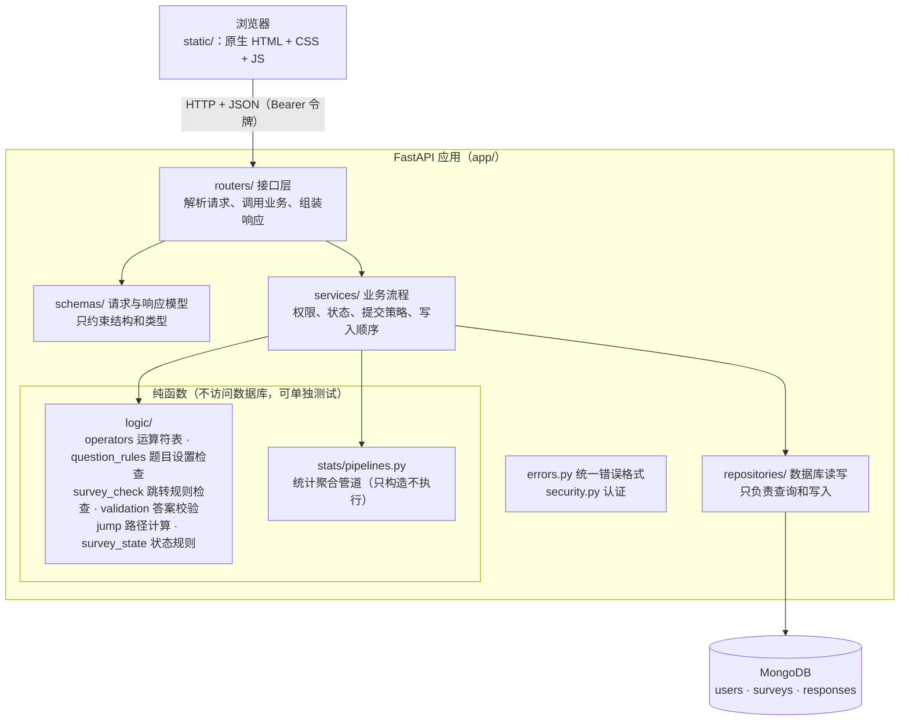
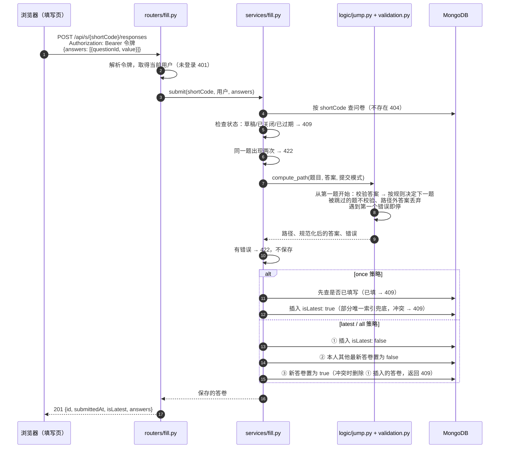
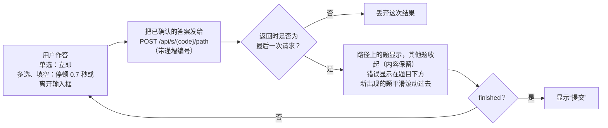
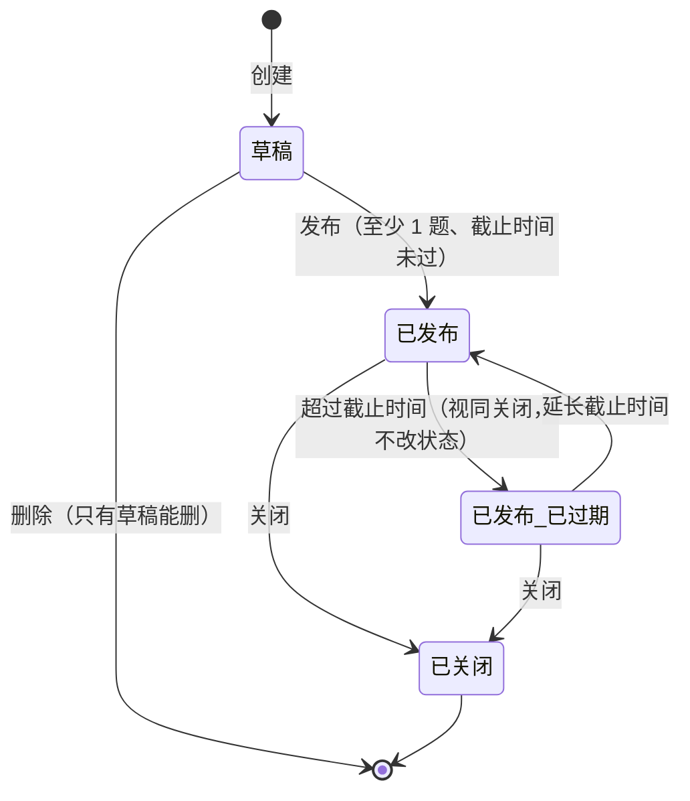

# 报告素材（第一阶段）

> 供开发者撰写实验报告时参考。按 CLAUDE.md 第 9 节的约定，这里只整理**要点、图表和数据**，不是报告正文。
> 每条都标注出处：`AI_LOG #n` 指 [docs/AI_LOG.md](AI_LOG.md) 第 n 条，`设计 x.y` 指 [docs/DATABASE_DESIGN.md](DATABASE_DESIGN.md) 第 x.y 节。

## 1. 项目概况数据

| 项目 | 数据 |
|---|---|
| 开发时间 | 2026-10-19 至 2026-10-20（设计讨论在 claude.ai，编码在 Claude Code） |
| 提交次数 | 22 次（每一步一次提交，另有修正提交） |
| AI 使用日志 | 28 条 |
| 后端代码（`app/`） | 约 2450 行（非空行，下同） |
| 脚本（`scripts/`） | 约 190 行 |
| 前端（`static/`） | JS 约 1630 行、CSS 约 330 行、HTML 约 260 行 |
| 测试代码 | Python 约 3130 行，界面测试与前端测试（JS）约 570 行 |
| 接口 | 22 个（账号 3、问卷 7、题目 4、填写 3、统计 3、元数据 1、健康检查 1） |
| 集合 | 3 个（users、surveys、responses），索引 6 个，三个集合都有 `$jsonSchema` 校验 |
| 测试 | 649 个全部通过，代码覆盖率 99% |

**开发时间线（提交记录）**

| 时间 | 提交 | 内容 |
|---|---|---|
| 10-19 18:57 | `74dba40` | 第一步：项目骨架与配置 |
| 10-19 19:20 | `ea5b299` | 第二步：数据库连接、`$jsonSchema` 校验与索引 |
| 10-19 19:27–19:30 | `1ab1a0b`、`70627ea` | 加入需求原文、完成清单；对照需求补充设计（整数范围、统计人数口径） |
| 10-19 19:36 | `17dc281` | 第三步：注册登录与统一错误格式 |
| 10-19 19:52 | `15e5359` | 第四步：问卷增删改查与状态 |
| 10-19 20:00 | `bf07e80` | 修正：开发者手动测试发现的 JSON 错误提示问题 |
| 10-19 20:13 | `dd9843a` | 第五步：题目编辑与跳转规则合法性检查 |
| 10-19 20:33 | `a89a1b9` | 第六步：跳转与校验引擎（纯函数） |
| 10-19 20:45 | `497e1e3` | 第七步：填写与提交；修正设计文档 6.2 |
| 10-19 21:00 | `ae87ad4` | 第八步：统计；设计文档新增聚合管道一节 |
| 10-19 21:20–22:31 | `6595c2b`、`a89bf30`、`fb6798d` | 9a 前端公共部分；开发者否决第一版样式后重做 |
| 10-19 22:42 | `c395c8b` | 9b 编辑页 |
| 10-19 23:04 | `bbdb373` | 9c 填写页；界面测试整理进项目 |
| 10-20 15:14 | `13028f2` | 9d 统计页 |
| 10-20 16:06 | `a32448d` | 第十步：示例数据、测试补全、TEST_CASES |
| 10-20 | （本步） | 第 11 步：README 与文档 |

## 2. 系统设计

### 2.1 后端分层结构

### 2.2 模块划分

| 模块 | 职责 | 主要文件 | 对应设计 |
|---|---|---|---|
| 配置与数据库 | 读取 `.env`；共享 MongoClient；集合校验规则与索引 | `config.py`、`db.py`、`db_schema.py` | 设计 5、5.1 |
| 认证 | bcrypt、JWT、当前用户 | `security.py`、`services/auth.py` | 设计 2 |
| 问卷管理 | 创建、修改、删除、发布、关闭；状态规则表 | `services/surveys.py`、`logic/survey_state.py` | 设计 6.4 |
| 题目编辑 | 增删改、排序；保存时整体检查；编辑冲突 | `services/questions.py`、`logic/question_rules.py`、`logic/survey_check.py` | 设计 3.1–3.3、6.3 第 9–11 条 |
| 运算符表 | 每种题型的运算符、值格式、判断方法（检查与计算共用一处） | `logic/operators.py` | 设计 3.3 |
| 填写与提交 | 路径预览、提交、三种提交策略的写入顺序 | `services/fill.py`、`logic/jump.py`、`logic/validation.py` | 设计 6.2、6.3、6.6 |
| 统计 | 聚合管道、统计口径、答卷列表 | `stats/pipelines.py`、`services/stats.py` | 设计 6.7、6.8 |
| 前端 | 登录、我的问卷、编辑、填写、统计；题目渲染器两处共用 | `static/js/*.js` | AI_LOG #21–#26 |

### 2.3 一次提交请求的处理流程

### 2.4 填写过程中的路径预览（滚动式填写页）

### 2.5 问卷状态

## 3. MongoDB 设计要点

| 要点 | 内容 | 出处 |
|---|---|---|
| 三个集合 | users、surveys（题目嵌入）、responses（每次提交一条） | 设计 1、7 |
| 题目为什么嵌入问卷 | 总是和问卷一起读写；数量有限远低于 16MB；只有创建者编辑；一次写入保证一致性；跳转合法性检查在同一文档内完成；数组顺序即题目顺序 | 设计 7.1；开发者决定 AI_LOG #5 |
| 答卷为什么单独存 | 数量无上限；多人同时提交不争抢同一文档；统计需要对大量答卷聚合并建索引 | 设计 7.2 |
| 稳定 id | 题目和选项都用系统生成的 id，跳转规则和答卷引用 id，调整顺序、修改选项文字不影响 | 设计 7.3；格式 AI_LOG #7 |
| answers 用 `{questionId, value}` 数组 | 所有题型共用同一聚合管道前三步；一个 `answers.questionId` 索引覆盖所有题；值保持原类型（数字可直接 `$avg`） | 设计 6.8 对比表；开发者决定 AI_LOG #5 |
| 不冗余存储 | 不在答案中冗余题型；统计结果实时计算不预存 | 设计 7.5 |
| 规则存为数据 | 校验与跳转都是题目上的数据，程序只解释；条件用结构化 `{op, value}` | 设计 7.7 |
| 提交策略用枚举 | `once` / `latest` / `all`，只有合法状态，新增策略只需新增取值 | 设计 7.8；开发者提出场景 AI_LOG #3 |
| isLatest + 部分唯一索引 | 每人每份问卷最多一份最新答卷；同时承担并发保护 | 设计 5、6.2；AI_LOG #3、#7 |
| `$jsonSchema` 宽松校验 | 只约束核心字段，不禁止额外字段，`moderate` 级别，为第二阶段加字段留余地 | 设计 5.1；AI_LOG #7 |
| 为什么适合 MongoDB | 题型多态、树状结构、答案类型不统一、结构演化灵活、聚合管道 | 设计 8 |

## 4. 跳转设计与校验设计要点

### 4.1 跳转

- **规则结构**：`logic: { rules: [{ when: {op, value}, goto }], defaultNext }`；13 种运算符（单选 2、多选 4、数字 7），文本题不支持跳转（设计 3.3）。
- **约定**：第一条命中为准；只能往后跳；`END` 结束；选填未答不匹配任何规则；被跳过的题不显示、不校验、不存储（设计 6.3）。
- **保存时检查**（`logic/survey_check.py`）：运算符与题型匹配、值格式、只能引用本题选项、只能往后跳；每次增删改、排序后整体检查；警告：规则重叠（区间运算，整数题按整数判断）、永远不会成立的规则、永远不会显示的题（从第一题出发的可达性分析）。
- **提交时重算**（`logic/jump.py`）：后端不信任前端，从第一题按答案重新计算路径；预览与提交共用同一函数，只在“答案中没有这道题”时不同。
- **单一来源**：运算符表只在 `logic/operators.py` 定义一处，保存检查、路径计算、前端规则编辑器（通过 `/api/meta`）共用。
- **测试**：13 种运算符 30 组判断、多条规则命中顺序、往前跳、调整顺序后变成往前跳、设计文档示例问卷全部 5 条路径（TEST_CASES D、F 组）。

### 4.2 校验

| 层次 | 时机 | 内容 | 实现 |
|---|---|---|---|
| 请求格式 | 每个请求 | 类型、必填字段、多余字段；统一中文错误格式 | `schemas/`、`errors.py` |
| 题目设置 | 保存题目 | 各题型允许的字段、取值范围、min ≤ max、类型严格（布尔不当数字） | `logic/question_rules.py` |
| 跳转规则 | 保存题目 | 见 4.1 | `logic/survey_check.py` |
| 答案 | 预览与提交 | 未作答判定、必答、单选/多选/文本/数字规则、64 位整数范围、规范化保存 | `logic/validation.py` |
| 数据库 | 写入 | `$jsonSchema` 核心字段、唯一索引、部分唯一索引 | `db_schema.py` |

- 校验与跳转分离：validation 决定“能怎么答”，logic 决定“答完去哪”（设计 6.3 第 7 条）。
- 测试：各题型边界、需求原文的年龄 0–120 整数和手机号例子、64 位边界（TEST_CASES C、E、I 组）。

## 5. 关键设计决定汇总

“决定者”一栏：**开发者** = 开发者提出或决定；**采纳 AI** = AI 建议、开发者确认；**AI 发现** = AI 在实现时发现设计问题，开发者确认修改方案。

| 决定 | 理由 | 决定者 | 出处 |
|---|---|---|---|
| 题目嵌入问卷、答卷单独存 | 见第 3 节 | 开发者 | AI_LOG #5；设计 7.1、7.2 |
| answers 用 `{questionId, value}` 数组，不冗余题型 | 统一管道、单一索引 | 开发者 | AI_LOG #5 |
| 匿名方案 B：记录但不展示 | 兼顾“需要登录”“匿名”“禁止重复填写” | 开发者 | AI_LOG #3；设计 6.1 |
| 三种提交策略 once / latest / all | 按问卷场景决定“每次都算”还是“只算最后一份” | 开发者提出场景，AI 整理为枚举 | AI_LOG #3 |
| 运算符取舍（单选 eq/in，多选 4 种，数字 7 种，文本不跳转） | 够用且可检查 | 开发者 | AI_LOG #4 |
| 只能往后跳；路径外答案丢弃而非拒绝 | 避免死循环；不惩罚前端多传 | 开发者 | AI_LOG #4 |
| 三步写入顺序（不用事务） | 单机 MongoDB 不支持事务，保证失败时不会“没有最新答卷” | 采纳 AI | AI_LOG #7；设计 6.2 |
| once 直接插入，靠部分唯一索引拦截 | 简单且能防并发重复 | 开发者补充 | AI_LOG #7 |
| 只保留部分唯一索引，删除重复的普通索引 | 查询带 isLatest: true 即可命中 | 开发者 | AI_LOG #7；设计 5 |
| 发布后可改标题、说明、截止时间；匿名和策略锁定 | 后两者影响已收集答卷的统计口径和隐私承诺 | 开发者 | AI_LOG #7；设计 6.4 |
| 统计同时返回答卷数和作答人数 | 需求原文“多少人回答”在 all 策略下与答卷数不同 | 开发者 | AI_LOG #12；设计 6.7 |
| 整数答案限制在 64 位范围 | 超出时 MongoDB 写入失败 | AI 发现 | AI_LOG #12；设计 6.6 |
| 添加题目不接受跳转规则（两步保存） | 新题的选项 id 尚未生成 | 采纳 AI | AI_LOG #16 |
| 编辑冲突检查可选、不用 version 字段 | 方便手动测试；version 留给第二阶段 | 开发者 | AI_LOG #16 |
| 遇到第一个错误就停 | 答案不合法时无法确定下一题 | 采纳 AI | AI_LOG #17 |
| **第 ③ 步冲突时撤销刚插入的答卷再返回 409** | 原设计中 409 时答卷已存入，all 策略下用户重交会算两次 | **AI 发现** | AI_LOG #18；设计 6.2 修正 |
| 填写者看不到跳转规则 | 只需知道下一题；避免根据规则刻意选答案 | 采纳 AI（开发者补充理由） | AI_LOG #18 |
| 用户名在管道中 `$lookup`，匿名管道不含此步 | 在数据库层面保证不泄露填写人 | 采纳 AI | AI_LOG #19；设计 6.8 |
| 填写页滚动式 + 只采用最后一次预览结果 | 体验更像问卷；避免旧结果覆盖新结果 | 开发者（否决 AI 的一屏一题） | AI_LOG #21 |
| 纸质问卷风格、配色 | 不像后台管理系统 | 开发者 | AI_LOG #21、#23 |
| 示例问卷实名、latest、不限截止时间 | 演示显示用户名、修改答案，链接不过期 | 开发者 | AI_LOG #27 |

## 6. 开发中遇到的问题和解决方法

| 问题 | 怎么发现 | 解决 | 出处 |
|---|---|---|---|
| 设计中“冲突时返回 409”时答卷其实已存入，all 策略下会重复计数 | AI 实现前对照设计文档 | 冲突时先删除刚插入的答卷再返回 409；写入设计修订记录 | AI_LOG #18 |
| 超长整数会超出 MongoDB 64 位整数范围导致写入失败 | AI 对照需求原文（手机号例子） | 校验时检查范围；数据库层测试证明问题存在 | AI_LOG #12 |
| 设计中两个索引键相同 | AI 审阅设计 | 只保留部分唯一索引 | AI_LOG #7 |
| 整份提交题目数组时新题没有 id，跳转规则无法引用 | AI 审阅设计 | 单题接口 + 两步保存 | AI_LOG #7、#16 |
| JSON 格式错误时 `field` 显示为字符位置 | 开发者在 /docs 手动测试 | field 固定为 body，位置写进 message | AI_LOG #15 |
| 非 UTF-8 请求体返回英文错误 | AI 手动验证时（Git Bash 发送 GBK） | 统一错误格式补充 400 | AI_LOG #14 |
| Windows 上 `localhost` 每个请求慢约 2 秒 | AI 手动验证时排查 | 本地默认改为 127.0.0.1，README 说明原因 | AI_LOG #19、#20 |
| 部分 Windows 机器把 `.js` 识别为 text/plain，浏览器拒绝执行 | AI 预先排查 | 启动时显式登记 MIME 类型并测试 | AI_LOG #21 |
| 第一版样式像后台管理系统 | 开发者看页面 | 按开发者 10 条要求重做为方格纸问卷风格 | AI_LOG #23 |
| 页面出现文字 “null”、样式规则误伤整行选项等 | AI 用无界面 Chrome 截图 | 修正并在界面测试中加入检查 | AI_LOG #24 |
| 界面测试偶尔失败（约 1/6） | 反复运行 | 记录失败现场后复现，发现是测试选择器把编辑器预览也算作题目，造成请求时序问题 | AI_LOG #25 |
| 统计柱状条底槽长短不一，误导比较 | AI 看截图 | 数字栏固定宽度，测试检查底槽等宽 | AI_LOG #26 |
| 部分并发保护分支只在并发中偶然执行到 | 覆盖率检查 | 用 monkeypatch 确定地触发；覆盖率 97% → 99% | AI_LOG #27 |
| bat 脚本中文被 cmd 误解析 | AI 运行脚本 | 改为纯英文 ASCII | AI_LOG #10 |
| `.env.example` 的示例密钥（33 个字符）能通过“至少 32 个字符”的检查，部署时忘记修改也能启动 | AI 干净环境验证 | 开发者决定拒绝示例值；同时让配置报错不回显密钥 | AI_LOG #28、#29 |

## 7. AI 使用情况

### 7.1 AI 做了什么

| 阶段 | AI 的工作 | 出处 |
|---|---|---|
| 设计讨论（claude.ai） | 总结需求；解释建模问题；提出匿名两种方案、isLatest、提交策略枚举、跳转规则结构；整理设计文档和 CLAUDE.md | AI_LOG #1–#6 |
| 编码前审阅 | 复述理解；确认技术栈；审阅设计提出 14 个问题；给出目录结构、API 草案、计划、测试方案 | AI_LOG #7 |
| 每一步编码前 | 列出接口和规则，与设计文档逐条对照，提出待决定事项供开发者选择 | AI_LOG #13–#27 |
| 实现 | 后端全部模块、前端全部页面、示例数据脚本、测试 649 个 | 各步骤 |
| 验证 | 每步运行测试；在真实服务上手动验证；用无界面 Chrome 截图检查前端；覆盖率检查 | 各步骤 |
| 文档 | 每步同步设计文档（见其“修订记录”）、CHECKLIST、TEST_CASES、README、本素材；维护 AI_LOG | 各步骤 |

### 7.2 AI 出过的错

按类型分组；“发现者”说明是谁发现的。

**工具与操作失误**

| 错误 | 发现者 | 处理 | 出处 |
|---|---|---|---|
| 用 `taskkill /IM python.exe` 加通配过滤结束测试服务，可能结束本机所有 Python 进程 | AI 自查后主动报告 | 开发者确认未受影响，并要求在 CLAUDE.md 加入“按端口或 PID 结束进程”规则 | AI_LOG #8、#9 |
| 把 `git status` 输出中的 `??`（未跟踪文件）误当成需求原文内容，报告“原文带问号” | AI 核对文件字节后更正 | 向开发者更正 | AI_LOG #12 |
| 用脚本批量修改文件时一处没匹配上，导致部分文件改了一半 | AI | 检查后用编辑工具补完 | AI_LOG #13 |
| 生成 README 时转义错误，`\to`、`\bin` 变成制表符和退格符 | AI | 修正 | AI_LOG #10 |
| shell 写文件时反斜杠被吞，测试数据变成合法地址 | 测试失败后 AI 排查 | 改用编辑工具 | AI_LOG #21 |
| 清理数据的 mongosh 命令写错 | AI | 重新执行 | AI_LOG #18 |
| 覆盖率数据文件 `.coverage` 被误提交 | AI | 新提交移除并加入 .gitignore | AI_LOG #28 |

**遗漏与设计层面的疏忽**

| 错误 | 发现者 | 处理 | 出处 |
|---|---|---|---|
| 统一错误格式漏了 400（非 UTF-8 请求体返回英文） | AI 手动验证 | 补充映射与测试 | AI_LOG #14 |
| JSON 格式错误时 field 显示为字符下标（AI 的测试只检查了 message） | **开发者** | 修正并加强测试 | AI_LOG #15 |
| 写了“之后会用到”的函数，后来设计改变后从未被调用 | 覆盖率检查 | 删除 | AI_LOG #27 |
| 第一版前端样式像后台管理系统 | **开发者** | 按开发者要求重做 | AI_LOG #23 |
| 新建问卷表单用了浏览器原生选框、间距过大 | **开发者截图** | 改为主题样式整行选项 | AI_LOG #22 |
| 原生 `append` 传入 null 使页面出现文字 “null”；CSS `.field > label` 误伤整行选项（9a 中也存在未被发现）；按钮文字竖排、短输入框被拉宽、预览填空线变灰块等 | AI 看界面测试截图 | 修正，并在界面测试中加入检查 | AI_LOG #24 |
| 统计柱状条底槽长短不一 | AI 看截图 | 固定数字栏宽度并测试 | AI_LOG #26 |

**测试代码的错误**（业务代码无误）

| 错误 | 出处 |
|---|---|
| 快照在写入题目之前取，5 个用例误报失败 | AI_LOG #14 |
| 两道题用了相同的选项 id；用字符串比较 ISO 时间（第四步的测试也有同样的潜在问题） | AI_LOG #16 |
| 写出无意义的表达式（`["q1_a"] and ["q2_b"]`、`q2 and q1`、“占位”列表推导式） | AI_LOG #17、#18 |
| 断言写得别扭（先转小写再替换字样再检查）；多余参数、`__import__` 写法 | AI_LOG #19、#27 |
| 用 print 输出“✓”在 GBK 控制台失败；latest 预填的期望写错 | AI_LOG #25 |
| 界面测试选择器把编辑器预览也算作题目，导致偶发失败 | AI_LOG #25 |

**提示文字与小问题**：提示中多余空格（两次，AI_LOG #16、#18）；占位页脚本的 `document.currentScript` 分支永远不会执行（AI_LOG #21）；填写页用假 id `"__finished__"` 记状态（AI_LOG #25）；统计口径说明重复（AI_LOG #26）。

### 7.3 开发者的决定和修改

**开发者提出的需求与设计**

- 设计讨论阶段：匿名与登录不冲突；“多次填写只算最后一份”；“按问卷场景决定每次都算还是只算最后一份”；三种提交策略都在第一阶段实现；质疑“多条规则同时满足是否因为限制不够严格”，讨论后明确单选/数字重叠可检查、多选重叠不可避免（AI_LOG #3、#4）。
- 选择匿名方案 B、answers 数组、题目嵌入（AI_LOG #3、#5）。
- 工作规则：小步推进、每步确认、只在本地提交、不推送直到同意、按端口或 PID 结束进程（AI_LOG #9）。
- 部署到阿里云 Linux：代码不写死本机路径和地址，问卷链接前缀可配置（AI_LOG #10）。
- 报告正文由本人撰写，AI 只整理素材（AI_LOG #12）。
- 把需求原文放入项目、建立完成清单（AI_LOG #11）。

**开发者否决或修改 AI 方案的地方**

| AI 的方案 | 开发者的决定 | 出处 |
|---|---|---|
| 发布后只允许延长截止时间 | 允许修改标题、说明、截止时间；锁定匿名和提交策略（并给出理由） | AI_LOG #7 |
| 保留两个键相同的索引并验证能否共存 | 只保留部分唯一索引 | AI_LOG #7 |
| 把 MongoDB 注册为 Windows 服务 | 改为手动启动脚本，服务方式保留为可选 | AI_LOG #10 |
| 每次保存都比对 updatedAt 做冲突检查 | 做成可选（请求带 expectedUpdatedAt 才检查）；明确不用 version 字段 | AI_LOG #16 |
| 填写页一屏一题 | 滚动式，并给出详细规则（含请求先后顺序） | AI_LOG #21 |
| 第一版样式（大块横幅、较大的控件） | 方格纸问卷风格，10 条具体要求，并指定全部配色 | AI_LOG #21、#23 |
| TEST_CASES 可以再精简 | 保持 97 条 | AI_LOG #27 |

**开发者发现的问题**：JSON 错误提示的 field（AI_LOG #15）；新建问卷表单的选框样式（AI_LOG #22）；第一版整体样式（AI_LOG #23）。

**开发者的验证**：在 /docs 手动测试第三、四步（AI_LOG #13、#14）；在浏览器中检查 9a–9d（AI_LOG #22–#26）；核实 httpx2 的替换（AI_LOG #8）。

## 8. 测试结果关键数据

（来自 2026-10-20 16:23 的完整运行，详见 [TEST_CASES.md](TEST_CASES.md)）

| 指标 | 数据 |
|---|---|
| 测试总数 | 649，全部通过，0 失败，0 跳过；在干净环境中按 README 运行同样全部通过 |
| 运行时间 | 37.0 秒 |
| 代码覆盖率 | 99%（`app/` 与 `scripts/` 共 1633 行，未覆盖 8 行） |
| 测试用例文档 | 98 条，按需求分 10 组，每条对应到测试函数 |
| 界面测试 | 3 个场景、29 个步骤，14 张关键截图 |
| 纯函数测试 | 校验 72、路径 74、规则检查 93、题目设置 56、状态 27 |
| 并发测试 | 8 线程同时发布只成功 1 次；10 人同时提交全部成功；同一人 8 线程同时提交，once 只成功 1 次，latest/all 最终恰好 1 份最新且 409 的不留答卷；8 线程同时添加题目不丢失修改 |
| 设计文档示例问卷 | 5 条路径全部正确；可通过接口完整搭建并发布 |
| 手工测试 | 9a–9d 浏览器检查全部通过；/docs 手动测试发现 1 个问题并修正 |

## 9. 为第二阶段准备的扩展点

| 可能的变化 | 已有的准备 | 代码位置 |
|---|---|---|
| 新增题型 | 题目公共字段 + 题型专属 validation；运算符表与检查规则按题型组织 | `logic/operators.py`、`logic/question_rules.py`、`static/js/render.js` |
| 新增运算符、组合条件 | 条件为结构化 `{op, value}`；运算符表单一来源，前端通过 `/api/meta` 自动获得 | `logic/operators.py` |
| 发布后修改问卷 | `version` / `surveyVersion` 字段已预留；状态规则写成数据表 | `logic/survey_state.py` |
| 新增问卷设置、提交策略 | `settings` 集中存放；策略为枚举，统计口径只在 `scope_filter` 定义 | `repositories/responses.py` |
| 新的统计维度、导出 | 只存原始答卷，统计实时计算；管道构造与执行分离 | `stats/pipelines.py` |
| 新增字段 | `$jsonSchema` 不禁止额外字段、`moderate` 级别；新字段可选并带默认值 | `db_schema.py`；设计 9 |
