# 测试用例

> 第一阶段测试说明：测试环境、运行方法、运行记录、测试用例（步骤、输入、期望输出、实际结果）、基于本人手工创建的问卷的端到端测试、界面测试与手工测试。
> 每条用例都对应到具体的自动测试函数（`文件::函数`），可以直接定位核对。

## 一、测试环境与运行方法

| 项目 | 版本 |
|---|---|
| 操作系统 | Windows 11 |
| Python | 3.14.2 |
| MongoDB | 8.3.11（mongosh 2.12.0） |
| FastAPI / PyMongo / Uvicorn | 0.147.0 / 4.19.0 / 0.54.0 |
| pytest / pytest-cov | 9.1.1 / 7.1.0 |
| Node.js（界面测试、前端纯函数测试） | 24.14.0 |
| Chrome（界面测试，无界面模式） | 155.0.8059.80 |

```bash
pytest                                   # 全部测试（含界面测试）
pytest -m "not ui"                       # 只跑后端测试（不需要 Node.js 和 Chrome）
pytest --cov=app --cov=scripts --cov-report=term-missing   # 代码覆盖率
```

**测试数据隔离**：
- 后端测试使用独立数据库 `survey_test`（`tests/conftest.py` 在导入应用前设置；库名不以 `_test` 结尾时直接报错，防止误清开发库）。整轮测试开始前重建、结束后删除；每个测试结束后清空各集合。
- 界面测试在空闲端口单独启动服务，使用独立数据库 `survey_ui_test`，结束后删除。
- 测试中 bcrypt 强度设为 4 以加快速度（正式运行为 12，有测试保证默认值）。

**测试分层**：

| 层次 | 内容 | 工具 |
|---|---|---|
| 纯函数单元测试 | 校验规则、跳转规则检查、路径计算、状态规则（不访问数据库） | pytest |
| 数据库测试 | `$jsonSchema` 校验、索引、部分唯一索引 | pytest + PyMongo |
| 接口测试 | 每个接口的正常与异常情况、权限、并发 | pytest + FastAPI TestClient |
| 界面测试 | 在真实页面中操作编辑、填写、统计 | Node.js 驱动无界面 Chrome（`tests/ui/`） |
| 手工测试 | 开发者按检查清单在浏览器中操作 | 浏览器 |

## 二、运行记录

**2026-10-20 16:23**，命令 `pytest --cov=app --cov=scripts`：

- **649 个测试全部通过**，0 失败，0 跳过，用时 37.0 秒。
- **代码覆盖率 99%**（`app/` 与 `scripts/` 共 1633 行，未覆盖 8 行，均为防御性分支和脚本入口行）。
- 此前 16:03 的运行为 645 个全部通过；之后新增 4 个配置测试（拒绝示例密钥，见 A9）。
- 第 11 步在干净环境中（从仓库克隆、新建虚拟环境、完全按 README 操作）运行，同样全部通过。

| 测试文件 | 用例数 | 内容 |
|---|---|---|
| `test_auth.py` | 52 | 注册、登录、令牌、统一错误格式 |
| `test_db.py` | 29 | 集合校验规则、索引、部分唯一索引、64 位整数存储 |
| `test_surveys.py` | 68 | 问卷创建、列表、修改、删除、发布、关闭、过期 |
| `test_survey_state.py` | 27 | 问卷状态规则表（纯函数） |
| `test_question_rules.py` | 56 | 单题设置检查（纯函数） |
| `test_survey_check.py` | 93 | 跳转规则合法性检查与警告（纯函数） |
| `test_questions.py` | 55 | 题目编辑接口、编辑冲突 |
| `test_validation.py` | 72 | 答案校验（纯函数） |
| `test_jump.py` | 74 | 答题路径计算（纯函数） |
| `test_fill.py` | 46 | 填写与提交、提交策略、并发 |
| `test_stats.py` | 28 | 统计与答卷列表 |
| `test_seed_demo.py` | 6 | 示例数据脚本 |
| `test_edge_cases.py` | 13 | 覆盖率检查后补充的边界情况 |
| `test_pages.py` | 18 | 页面路由、静态资源、`/api/meta` |
| `test_health.py` | 8 | 健康检查、配置（含拒绝示例密钥） |
| `test_frontend_js.py` | 1 | 前端纯函数（Node.js） |
| `test_ui.py` | 3 | 界面测试：编辑页、填写页、统计页（共 29 个步骤） |
| **合计** | **649** | |

## 三、测试用例

“实际结果”均为上述运行记录中的结果。同一测试点的多组输入合并为一行（参数化测试）。

### A. 账号

| 编号 | 测试点 | 步骤 | 输入 | 期望输出 | 实际结果 | 自动测试 |
|---|---|---|---|---|---|---|
| A1 | 注册成功 | POST `/api/auth/register` | `alice` / `password123` | 201，返回 id、username、createdAt，不含密码、不返回令牌 | 通过 | `test_auth.py::test_register_success`、`test_register_does_not_return_token` |
| A2 | 密码只存哈希 | 注册后查数据库 | 密码 `my-secret-pw` | `passwordHash` 以 `$2b$` 开头，文档中不含明文 | 通过 | `test_auth.py::test_password_stored_as_bcrypt_hash` |
| A3 | 用户名规则 | 注册 | `ab`、21 个字符、`al ice`、`alice!`、`张三丰`、全角字母 | 422，提示“长度应为 3~20 个字符”或“只能包含字母、数字和下划线” | 通过 | `test_auth.py::test_register_invalid_usernames` |
| A4 | 用户名大小写与空格 | 注册后再注册 | `  Alice_01 `；再注册 `ALICE` | 保存为 `alice_01`；`ALICE` 视为重名，409 | 通过 | `test_username_stored_lowercase_and_trimmed`、`test_register_duplicate_username_case_insensitive` |
| A5 | 密码长度边界 | 注册 | 7/8 个字符、72/73 字节、24/25 个汉字、5 个汉字 | 至少 8 个字符、最多 72 字节；5 个汉字（15 字节但只有 5 个字符）被拒 | 通过 | `test_auth.py::test_register_password_length` |
| A6 | 登录失败不泄露用户名是否存在 | 登录 | 正确用户名 + 错误密码；不存在的用户名 | 两者都返回完全相同的 401“用户名或密码错误” | 通过 | `test_login_wrong_password_and_unknown_user_same_response` |
| A7 | 令牌无效 | GET `/api/auth/me` | 无令牌、格式错误、他人密钥签名、已过期、用户不存在、缺少 sub、sub 不是合法 id | 401：`NOT_AUTHENTICATED` / `INVALID_TOKEN` / `TOKEN_EXPIRED` | 通过 | `test_auth.py::test_me_*`、`test_edge_cases.py::test_token_with_malformed_subject` |
| A9 | 拒绝不安全的 JWT 密钥 | 用不同的 `JWT_SECRET` 加载配置 | 少于 32 个字符；`.env.example` 中的示例值（前后带空格也算）；真实但过短的密钥 | 拒绝启动并提示生成命令；示例值单独提示“仍是 .env.example 中的示例值”；报错信息中不出现输入的密钥；`.env.example` 的示例值与程序拒绝的列表一致 | 通过 | `test_health.py::test_short_jwt_secret_rejected`、`test_example_jwt_secret_rejected`、`test_config_errors_do_not_echo_secret`、`test_example_secret_list_matches_env_example` |
| A8 | 统一错误格式 | 发送各种不合法请求 | 缺字段、类型错误、非法 JSON、非 UTF-8 请求体、未知路径、错误方法、未处理异常 | 统一为 `{code, message, errors?}` 的中文提示；JSON 错误位置写在 message 中；500 不暴露内部细节 | 通过 | `test_auth.py::test_*_unified_error_format`、`test_invalid_json_*`、`test_edge_cases.py::test_unexpected_error_returns_unified_500` |

### B. 问卷管理与状态

| 编号 | 测试点 | 步骤 | 输入 | 期望输出 | 实际结果 | 自动测试 |
|---|---|---|---|---|---|---|
| B1 | 创建问卷 | POST `/api/surveys` | 标题、说明、匿名、`latest`、截止 `2099-11-30T23:59:59+08:00` | 201，草稿；截止时间统一存 UTC（`15:59:59Z`）；链接不存库 | 通过 | `test_surveys.py::test_create_survey` |
| B2 | 默认值与 shortCode | 只填标题；连续创建 20 份 | — | 说明为空、不匿名、`once`；shortCode 为 6 位字母数字且互不重复；重复时自动重试 | 通过 | `test_create_defaults`、`test_short_code_and_url`、`test_short_codes_are_unique`、`test_short_code_collision_retries` |
| B3 | 字段校验 | 创建 | 空标题、101 字标题、1001 字说明、过去的截止时间、无时区时间、`daily` 策略、`"yes"` 作为布尔值 | 422，指出字段和原因 | 通过 | `test_create_invalid_fields`、`test_create_invalid_types`、`test_create_deadline_without_timezone_rejected` |
| B4 | 只能看到自己的问卷 | alice、bob 各建问卷后 alice 查列表 | — | 只含 alice 的问卷，新的在前，含题目数、答卷数 | 通过 | `test_list_only_my_surveys_newest_first`、`test_list_question_count` |
| B5 | 访问别人的问卷 | bob 对 alice 的问卷做查看/修改/删除/发布/关闭 | — | 与不存在的问卷返回完全相同的 404，数据不变 | 通过 | `test_surveys.py::test_cannot_access_others_survey` |
| B6 | 各状态可改字段 | 草稿、已发布、已关闭时分别修改 | 标题、说明、截止时间、匿名、提交策略 | 发布后只能改标题、说明、截止时间；匿名和策略 409 `FIELD_LOCKED`（说明原因）；关闭后全部拒绝；被拒时整个请求不生效 | 通过 | `test_update_published_allowed_fields`、`test_update_published_locked_fields`、`test_update_closed_rejected` |
| B7 | 相同值不算修改 | 已发布问卷提交与当前相同的锁定字段 | 原策略、原匿名设置 + 新标题 | 200，标题已修改 | 通过 | `test_update_same_value_on_locked_field_is_ok` |
| B8 | 发布条件 | 发布 | 无题目；截止时间已过；已发布再发布；已关闭再发布 | 422 `NO_QUESTIONS`；422 截止时间；409 `INVALID_STATUS` | 通过 | `test_publish_without_questions_rejected`、`test_publish_with_past_deadline_rejected`、`test_publish_twice_or_after_close_rejected` |
| B9 | 关闭与删除 | 关闭、删除 | 草稿关闭；已发布/已关闭删除 | 草稿不能关闭（409）；只能删除草稿 | 通过 | `test_close_draft_rejected`、`test_delete_draft`、`test_delete_non_draft_rejected` |
| B10 | 过期与延长 | 截止时间设为过去后查看、修改 | 延长截止时间或改为不限 | `isExpired` 为 true，状态仍为 published；延长后恢复为 false | 通过 | `test_expired_survey`、`test_extend_expired_survey_resumes` |
| B11 | 并发发布 | 8 个线程同时发布同一份问卷 | — | 只有 1 个成功，其余 `INVALID_STATUS` | 通过 | `test_surveys.py::test_concurrent_publish_only_one_succeeds` |
| B12 | 状态规则表 | 纯函数 | 3 种状态 × 4 种操作；5 个字段 | 与设计文档 6.4 的表格逐格一致 | 通过 | `test_survey_state.py::test_can`、`test_locked_fields` |

### C. 题目与题目设置校验

| 编号 | 测试点 | 步骤 | 输入 | 期望输出 | 实际结果 | 自动测试 |
|---|---|---|---|---|---|---|
| C1 | 添加题目 | POST `/api/surveys/{id}/questions` | 单选题“你喜欢吃水果吗？”，选项 喜欢/不喜欢 | 201；题目 id `q_`+6 位、选项 id `o_`+6 位，问卷内不重复 | 通过 | `test_questions.py::test_add_question`、`test_ids_unique_across_survey` |
| C2 | 插入位置 | 依次添加并指定 position | position=1、3、5；0、3（只有 1 题时）、-1 | 插入到指定位置；越界时 422 | 通过 | `test_add_appends_by_default_and_supports_position`、`test_add_invalid_position` |
| C3 | 添加时不接受跳转规则 | 添加题目时带 logic | — | 422“添加题目时不能设置跳转规则，请添加后通过修改题目设置” | 通过 | `test_questions.py::test_add_with_logic_rejected` |
| C4 | 多选数量设置 | 保存题目 | minSelect>maxSelect、maxSelect>选项数、0、负数、1.5、`true`、`"2"` | 拒绝并指出字段；“必须选 2 项”（min=max=2）合法 | 通过 | `test_question_rules.py::test_multiple_choice_select_counts`、`test_valid_settings` |
| C5 | 文本、数字设置 | 保存题目 | minLength>maxLength、maxLength=10001、min>max、`"0"` 作为 min、`integerOnly: "yes"` | 拒绝；年龄 0–120 整数、手机号整数等合法 | 通过 | `test_text_lengths`、`test_number_range`、`test_valid_settings` |
| C6 | 字段与题型不匹配 | 保存题目 | 单选带 minSelect、数字题带 minLength、文本题带 options | 直接拒绝，不静默忽略 | 通过 | `test_field_not_matching_type_rejected`、`test_non_choice_cannot_have_options` |
| C7 | 选项规则 | 保存题目 | 0 个选项、51 个选项、空选项文字、重复选项文字 | 拒绝 | 通过 | `test_choice_requires_options`、`test_option_count_limit`、`test_option_text_rules` |
| C8 | 修改选项时 id 稳定 | 修改选项文字后再查看跳转规则 | “不喜欢”改为“一点也不喜欢” | 选项 id 不变，引用它的规则仍有效；新增选项获得新 id | 通过 | `test_option_ids_stable_when_renaming`、`test_add_option_in_update_gets_new_id` |
| C9 | 发布后不能改题目 | 发布/关闭后添加、修改、删除、排序 | — | 409“问卷已发布，不能修改题目” | 通过 | `test_questions.py::test_cannot_edit_after_publish` |
| C10 | 编辑冲突 | 带过期的 `expectedUpdatedAt` 保存；8 线程并发添加 | — | 409 `EDIT_CONFLICT`；并发添加不丢失修改；同一毫秒内 updatedAt 仍严格递增 | 通过 | `test_expected_updated_at_stale`、`test_concurrent_edits_do_not_lose_updates`、`test_updated_at_strictly_increases` |

### D. 跳转规则的合法性检查（保存时）

| 编号 | 测试点 | 步骤 | 输入 | 期望输出 | 实际结果 | 自动测试 |
|---|---|---|---|---|---|---|
| D1 | 13 种运算符的合法值 | 整体检查 | 单选 eq/in；多选 contains/containsAny/containsAll/equals；数字 eq/ne/gt/gte/lt/lte/between | 无错误 | 通过 | `test_survey_check.py::test_valid_operator_values` |
| D2 | 运算符与题型不匹配 | 整体检查 | 单选用 contains、gt；多选用 eq、in；数字用 contains、like | 拒绝，指出运算符 | 通过 | `test_operator_must_match_type` |
| D3 | 条件值不合法 | 整体检查 | 不存在的选项、空数组、重复选项、别的题的选项、`"3"`、`true`、`between [5, 1]`、`between [1]` 等 17 种 | 拒绝，字段为 `logic.rules[0].when.value` | 通过 | `test_invalid_values`、`test_option_from_other_question_rejected` |
| D4 | 文本题不支持跳转 | 整体检查 | 文本题带 logic | 拒绝 | 通过 | `test_text_question_cannot_have_logic` |
| D5 | 往前跳被拒绝 | 整体检查 | 第 2 题跳到第 1 题；跳到本题自己；defaultNext 往前 | “第 2 题第 1 条规则：只能跳转到后面的题目或 END（目标是第 1 题）” | 通过 | `test_backward_or_self_jump_rejected`、`test_default_next_backward_rejected` |
| D6 | 调整顺序后变成往前跳 | 通过接口调整题目顺序 | 第 1 题规则跳到第 3 题，把第 3 题移到最前 | 422，顺序保持不变 | 通过 | `test_reorder_turns_forward_jump_into_backward`、`test_questions.py::test_reorder_causing_backward_jump_rejected` |
| D7 | 删除被引用的题目或选项 | 删除题目；修改题目时去掉被规则引用的选项 | — | 409 `QUESTION_REFERENCED`“第 1 题「…」的第 1 条规则跳转到这道题”；422 指出哪条规则 | 通过 | `test_delete_referenced_question_rejected`、`test_delete_option_referenced_by_rule_rejected` |
| D8 | 重叠警告 | 整体检查 | 单选两条规则含同一选项；数字 `gt 10` 与 `gte 18`；整数题 `gt 10` 与 `lt 11` | 单选、数字重叠给警告但允许保存；整数题交集无整数时不警告；多选不警告 | 通过 | `test_single_choice_overlap_warning`、`test_number_overlap_warning`、`test_number_overlap_ignored_when_no_integer_in_common`、`test_multiple_choice_overlap_not_warned` |
| D9 | 永远不会成立的规则、永远不会显示的题 | 整体检查 | 0–120 的题用 `gt 120`；整数题 `eq 2.5`；最多选 2 项却 `containsAll` 3 项；所有规则都绕过第 2 题 | 警告“永远不会成立”“在任何情况下都不会被显示” | 通过 | `test_number_rule_never_matches`、`test_multiple_choice_rule_never_matches`、`test_unreachable_question_warning`、`test_unreachable_chain` |
| D10 | 设计文档示例问卷 | 整体检查、通过接口搭建并发布 | 设计文档 3.4 的水果问卷 | 无错误、无警告，可以发布 | 通过 | `test_design_example_passes_without_warnings`、`test_questions.py::test_build_design_example_and_publish` |

### E. 答案校验

| 编号 | 测试点 | 步骤 | 输入 | 期望输出 | 实际结果 | 自动测试 |
|---|---|---|---|---|---|---|
| E1 | 未作答的判定 | 校验 | `null`、空白文本、多选 `[]` | 必答题“此题为必答题”；选填题视为未作答 | 通过 | `test_validation.py::test_blank_is_unanswered` |
| E2 | 选填题作答后必须合法 | 校验 | 选填文本（至少 5 字）填“太短” | “至少 5 个字（当前 2 个）” | 通过 | `test_optional_but_answered_must_be_valid` |
| E3 | 单选 | 校验 | 不是本题的选项、数组、数字、`""` | “选择的不是本题的选项”/“应选择一个选项” | 通过 | `test_single_invalid`、`test_single_empty_string_is_not_unanswered` |
| E4 | 多选数量 | 校验 | 至少 2 项选 1 项；最多 3 项选 4 项；必须 2 项选 1 项或 3 项；重复选项 | 对应提示，如“必须选择 2 项（当前选了 1 项）” | 通过 | `test_multi_count_limits`、`test_multi_invalid`、`test_multi_count_boundaries_ok` |
| E5 | 多选按选项顺序保存 | 校验 | 先选 C 再选 A | 保存为 `[A, C]` | 通过 | `test_multi_saved_in_option_order` |
| E6 | 文本字数 | 校验 | 2–4 字的题：`a`、`" ab "`、`abcde`、`闻着臭吃着`；带肤色 emoji | 去首尾空白后按 Unicode 字符计数；汉字算 1 个；emoji 可能算多个 | 通过 | `test_text_length_boundaries`、`test_text_length_counts_unicode_code_points` |
| E7 | 数字类型 | 校验 | `"7"`、`true`、`[7]`、NaN、Infinity | “应填写数字” | 通过 | `test_number_must_be_json_number`、`test_number_rejects_nan_and_infinity` |
| E8 | 年龄 0–120 整数（需求原文） | 校验 | 0、120、-1、121、0.0、119.5 | -1“不能小于 0”；121“不能大于 120”；119.5“必须为整数”；`3.0` 存为 `3` | 通过 | `test_number_age_example`、`test_integer_only_converts_float` |
| E9 | 手机号与 64 位整数范围 | 校验 | 13812345678；2⁶³−1、−2⁶³、2⁶³、10²⁰ | 手机号合法；超出 64 位范围时提示“数值超出允许范围”（不论是否 integerOnly） | 通过 | `test_phone_number_example`、`test_int64_range` |

### F. 跳转路径计算

| 编号 | 测试点 | 步骤 | 输入 | 期望输出 | 实际结果 | 自动测试 |
|---|---|---|---|---|---|---|
| F1 | 13 种运算符判断 | 纯函数 | 30 组（含 between 两端、equals 不看顺序、`3` 等于 `3.0`） | 成立/不成立正确 | 通过 | `test_jump.py::test_operator_semantics` |
| F2 | 规则命中与默认去向 | 计算路径 | 命中规则；未命中且无默认去向；未命中有默认去向 | 跳到目标；顺序下一题；跳到默认去向 | 通过 | `test_rule_hit_jumps`、`test_no_rule_hit_without_default_goes_next`、`test_no_rule_hit_with_default_next` |
| F3 | 多条规则命中顺序 | 计算路径 | 多选 `containsAll[A,B]`（第 1 条）与 `contains A`（第 2 条），选 A、B | 按第 1 条跳转 | 通过 | `test_first_matching_rule_wins`、`test_first_matching_rule_wins_number_overlap` |
| F4 | 结束问卷 | 计算路径 | 规则或默认去向为 END | 路径结束，之后的答案被丢弃 | 通过 | `test_goto_end` |
| F5 | 选填题未作答 | 计算路径 | 数字题规则 `ne 5`，值为 null | 不判断任何规则（`ne` 也不成立），走默认去向 | 通过 | `test_optional_unanswered_skips_rules` |
| F6 | 被跳过的必答题 | 计算路径 | 第 1 题跳到第 3 题，第 2 题（必答）提交了不合法的 999 | 不报错、不校验、不保存第 2 题 | 通过 | `test_skipped_required_question_not_checked` |
| F7 | 路径外多余答案丢弃 | 计算路径 | 结束后的答案、问卷中不存在的题目 id | 丢弃，不报错 | 通过 | `test_unknown_question_ids_discarded`、`test_fruit_survey_skipped_answers_discarded` |
| F8 | 遇到第一个错误即停 | 计算路径 | 第 1、2 题都不合法 | 只返回第 1 题的错误；“第 N 题”是问卷中的位置 | 通过 | `test_stops_at_first_error`、`test_error_message_uses_position_in_survey_not_in_path` |
| F9 | 预览与提交两种模式 | 计算路径 | 答案中没有某题；有该题但值为空 | 预览：停在该题作为下一题；提交：视为未作答 | 通过 | `test_preview_stops_at_first_unreached_question`、`test_preview_explicit_blank_means_skipped`、`test_submit_treats_missing_as_unanswered` |
| F10 | 示例问卷的全部路径 | 计算路径 | 设计文档 3.4 的 5 条路径 | 不喜欢→第 5 题；选了榴莲→第 3 题；没选榴莲→第 4 题；每周 0 次→结束 | 通过 | `test_jump.py::test_fruit_survey_paths` |
| F11 | 数据异常保护 | 计算路径 | 规则被绕过接口改成往前跳 | 抛出错误（接口返回 500），不会死循环 | 通过 | `test_backward_or_missing_target_raises`、`test_fill.py::test_corrupted_logic_returns_500_not_loop` |

### G. 填写与提交

| 编号 | 测试点 | 步骤 | 输入 | 期望输出 | 实际结果 | 自动测试 |
|---|---|---|---|---|---|---|
| G1 | 填写者看到的问卷 | GET `/api/s/{shortCode}` | — | 题目只含 id/type/title/options/validation，不含跳转规则和 ownerId | 通过 | `test_fill.py::test_respondent_cannot_see_logic_or_owner` |
| G2 | 填写需要登录 | 未登录访问 | — | 401 | 通过 | `test_get_requires_login` |
| G3 | 各状态的访问 | 草稿（他人/创建者）、已关闭、已过期 | — | 他人看草稿 404“问卷尚未发布”；创建者可预览不可提交；已关闭/已过期获取问卷 200 加提示、不含题目，预览和提交 409 | 通过 | `test_draft_hidden_from_others`、`test_owner_can_preview_draft_but_not_submit`、`test_closed_or_expired` |
| G4 | 截止/关闭后拒绝提交 | 关闭或过期后提交；再延长截止时间 | — | 409 `SURVEY_CLOSED`/`SURVEY_EXPIRED`，不保存；延长后可以提交 | 通过 | `test_close_via_api_then_submit_rejected`、`test_extended_deadline_resumes_submission` |
| G5 | 逐题预览 | POST `/path` | 逐步增加答案 | 依次返回下一题，结束时 finished；不保存 | 通过 | `test_preview_step_by_step`、`test_preview_does_not_save` |
| G6 | 提交时后端重算路径 | 提交 | 选“不喜欢”并提交第 2~4 题的答案（其中有不合法的） | 201，只保存第 1、5 题 | 通过 | `test_submit_discards_off_path_answers`、`test_skipped_required_not_needed` |
| G7 | 保存规范化后的答案 | 提交 | 多选 `[榴莲, 苹果]`、文本带首尾空白、数字 `7.0`、空白文本 | 保存 `[苹果, 榴莲]`、去空白文本、整数 `7`；空白视为未作答不保存 | 通过 | `test_submit_saves_normalized_answers` |
| G8 | 不合法的提交 | 提交 | 必答未答、字数不足、`"7"`、2⁶³ | 422“答案不合法”，只返回一个错误，不保存 | 通过 | `test_submit_invalid_rejected_and_not_saved` |
| G9 | once 策略 | 同一人提交两次 | — | 第二次 409“你已经填写过这份问卷（每人只能填写一次）” | 通过 | `test_policy_once` |
| G10 | latest 策略 | 同一人提交三次 | — | 三份都保留，只有最后一份 isLatest；返回本人最新答案用于预填（不返回他人的） | 通过 | `test_policy_latest`、`test_latest_answers_only_own` |
| G11 | all 策略 | 同一人提交三次 | — | 三份都保留并都计入；isLatest 仍维护 | 通过 | `test_policy_all` |
| G12 | 匿名仍记录填写人 | 匿名问卷提交 | — | 数据库记录 respondentId；同一人再次提交仍被拦截 | 通过 | `test_anonymous_still_records_respondent` |
| G13 | 多人同时填写 | 10 人同时提交 | — | 全部 201 | 通过 | `test_many_users_submit_concurrently` |
| G14 | 同一人并发提交 | 8 线程同时提交 | once / latest / all | once 只成功 1 次；latest/all 最终恰好一份最新，返回 409 的没有留下答卷 | 通过 | `test_concurrent_once_only_one_saved`、`test_concurrent_same_user_latest_switch` |
| G15 | 第 ③ 步冲突撤销（设计文档 6.2 修正） | 模拟第 ③ 步触发唯一索引冲突 | — | 删除刚插入的答卷，返回 409“本次提交未保存” | 通过 | `test_step3_conflict_deletes_inserted_response` |
| G16 | once 唯一索引兜底 | 模拟两次提交都通过了事先查询 | — | 插入时被部分唯一索引拦截，409，不留下答卷 | 通过 | `test_edge_cases.py::test_once_duplicate_key_fallback` |
| G17 | 请求格式 | 提交 | 同一题出现两次；缺 value；多余字段；201 项答案 | 422 | 通过 | `test_duplicate_question_rejected`、`test_request_format`、`test_answers_limit_200` |

### H. 统计

固定数据：设计文档 3.4 的问卷，4 人按不同路径填写（张三：喜欢→苹果、榴莲→理由→7→建议；李四：喜欢→苹果、香蕉→3；王五：不喜欢→建议；赵六：喜欢→香蕉→0）。

| 编号 | 测试点 | 步骤 | 输入 | 期望输出 | 实际结果 | 自动测试 |
|---|---|---|---|---|---|---|
| H1 | 单选统计 | GET `/stats` | 固定数据 | 喜欢 3、不喜欢 1；答卷数 4、作答人数 4 | 通过 | `test_stats.py::test_whole_survey_stats` |
| H2 | 多选统计 | 同上 | 同上 | 苹果 2、香蕉 2、西瓜 0、榴莲 1（按选项顺序，没人选的为 0）；答卷数 3（王五跳过） | 通过 | 同上 |
| H3 | 填空统计 | 同上 | 同上 | 文本列出全部内容（新的在前）；数字 `[0, 3, 7]`，平均值 10/3 | 通过 | 同上；`test_number_average_with_floats` |
| H4 | 单题统计 | GET `/stats/questions/{qid}` | — | 与整份统计中该题一致；填空题可分页查看全部 | 通过 | `test_single_question_stats`、`test_question_items_pagination`、`test_whole_survey_lists_20_items_single_question_lists_all` |
| H5 | 三种策略的口径 | 张三改答案后统计 | latest / all / once | latest 只算新答案（喜欢 2、不喜欢 2）；all 答卷数 5、作答人数 4；once 第二次不计入 | 通过 | `test_policy_latest_counts_only_latest`、`test_policy_all_counts_every_submission`、`test_policy_once_second_submission_not_counted` |
| H6 | 三处数字一致 | 比较问卷列表、统计、答卷列表 | 三种策略 | 答卷数完全一致 | 通过 | `test_counts_consistent_across_endpoints` |
| H7 | 匿名不返回填写人 | 统计、单题统计、答卷列表 | 匿名问卷 | 返回内容中不出现任何用户名、用户 id、username/respondentId 字段；作答人数仍返回 | 通过 | `test_anonymous_hides_respondents_everywhere` |
| H8 | 实名显示用户名 | 同上 | 实名问卷 | 填空内容与答卷列表显示用户名，不含 respondentId、passwordHash | 通过 | `test_non_anonymous_shows_usernames` |
| H9 | 空问卷与权限 | 无答卷时统计；他人访问 | — | 全为 0、平均值 null；他人 404、未登录 401 | 通过 | `test_empty_survey_stats`、`test_only_owner_can_view` |
| H10 | 聚合管道结构 | 检查管道 | — | 四种题型共用前三步；匿名管道不含 `$lookup`、不输出 respondentId；第一步使用索引（IXSCAN） | 通过 | `test_question_pipelines_share_first_three_stages`、`test_anonymous_pipelines_have_no_lookup`、`test_question_stats_uses_index` |

### I. 数据库 schema 与索引

| 编号 | 测试点 | 步骤 | 输入 | 期望输出 | 实际结果 | 自动测试 |
|---|---|---|---|---|---|---|
| I1 | 集合与校验规则 | 初始化后检查集合 | — | 三个集合都有 `$jsonSchema`，`validationLevel: moderate` | 通过 | `test_db.py::test_collections_created_with_validator` |
| I2 | 不合法文档被拒 | 直接写数据库 | 缺 passwordHash、非法状态、ownerId 为字符串、非法提交策略、非法题型、version=0、isLatest 为字符串等 10 种 | 写入失败（错误码 121） | 通过 | `test_invalid_documents_rejected` |
| I3 | 允许新增字段（为第二阶段预留） | 写入带额外字段的文档 | 选项配图、作答用时、人数上限 | 写入成功 | 通过 | `test_extra_fields_allowed_for_future_extension` |
| I4 | 索引与设计一致 | 检查索引 | — | 字段、唯一性、部分过滤条件与设计文档第 5 节一致；已删除的普通索引不存在 | 通过 | `test_indexes_match_design` |
| I5 | 部分唯一索引 | 写入答卷 | 同一人两份 isLatest:true；多份 false | 前者被拒；后者允许；不同人/不同问卷互不影响 | 通过 | `test_only_one_latest_response_per_user`、`test_multiple_non_latest_responses_allowed` |
| I6 | 64 位整数存储 | 写入答卷 | 2⁶³−1、−2⁶³、手机号；2⁶³、10²⁰ | 前者原样读回；后者无法写入（说明应用层必须提前拒绝） | 通过 | `test_int64_boundary_values_can_be_stored`、`test_int_beyond_int64_cannot_be_stored` |
| I7 | 初始化幂等 | 重复执行初始化 | — | 不报错、索引不重复 | 通过 | `test_ensure_schema_is_idempotent`、`test_edge_cases.py::test_init_db_script` |

### J. 示例数据

| 编号 | 测试点 | 步骤 | 输入 | 期望输出 | 实际结果 | 自动测试 |
|---|---|---|---|---|---|---|
| J1 | 生成示例问卷 | `python -m scripts.seed_demo` | — | “大学生饮食习惯调查”已发布，12 题，无错误无警告，覆盖四种题型和三类跳转 | 通过 | `test_seed_demo.py::test_seed_creates_published_demo_survey`、`test_seed_covers_types_jumps_and_validations` |
| J2 | 不同路径的答卷 | 同上 | — | 13 份答卷、12 位填写人；选“否”的只答第 1 题；各路径符合跳转规则 | 通过 | `test_seed_responses_follow_different_paths` |
| J3 | 重复运行与重置 | 运行两次；`--reset` | — | 第二次不重复生成；重置只删示例问卷，不碰其他数据 | 通过 | `test_seed_is_idempotent`、`test_seed_reset_recreates`、`test_seed_demo_command_line` |

## 四、基于本人手工创建的问卷的端到端测试

> **问卷由开发者本人在网页上手工创建并发布**（“大学生运动习惯调查”，创建者账号 `hanmeimei`，链接 `http://127.0.0.1:8000/survey/Z2alVy`，8 道题，`latest` 策略，实名）。**填写数据由脚本模拟**：[`scripts/sport_survey_e2e.py`](../scripts/sport_survey_e2e.py) 创建 15 个填写人账号（`sport_u01`~`sport_u15`）和 1 个提交不合法答卷的账号（`sport_invalid`），**全部通过 HTTP 接口操作**（与网页走同样的校验和路径计算），不直接读写数据库，不修改创建者账号。
>
> 与其他测试不同，这份问卷不是测试代码生成的，可以检验系统对“真实用户设计的问卷”是否表现正确。

**运行方法**（先启动 MongoDB 和服务）：

```bash
python -m scripts.sport_survey_e2e                    # 统计核对时提示输入创建者密码（不回显、不保存）
python -m scripts.sport_survey_e2e --skip-stats       # 不核对统计
```

重复运行时已提交过的账号不再提交（只做核对）。任何一项不一致时退出码为 1；问卷结构或路径与预期不一致时，在提交任何答卷之前就停止。

### 1. 问卷的实际规则（运行前从数据库只读读出，与开发者的描述核对）

| 题 | 题型与题目 | 校验 | 跳转规则 |
|---|---|---|---|
| 1 | 数字：你的年龄（周岁）？ | 必答，14–30 的整数 | 无（开发者原描述为“小于 16 直接结束”，实际问卷中没有这条规则；问卷已发布无法修改，开发者决定按实际规则填写） |
| 2 | 单选：你平时运动的频率是？ | 必答 | 每月几次 → 第 7 题；基本不运动 → 第 7 题 |
| 3 | 多选：你经常做哪些运动？ | 必答，1–3 项 | ① 同时选中篮球和羽毛球 → 第 5 题；② 选中健身 → 第 4 题；其他 → 第 5 题 |
| 4 | 单选：你每次在健身房大约待多久？ | 必答 | — |
| 5 | 数字：你每次运动大约多少分钟？ | 必答，1–300 的整数 | 1 到 15（含 15）→ 第 8 题 |
| 6 | 单选：你觉得自己的运动量够吗？ | 必答 | 其他 → 第 8 题（跳过第 7 题） |
| 7 | 多选：你不常运动的主要原因是？ | 必答，1–2 项 | — |
| 8 | 文本：你对学校的体育设施有什么建议？ | 选填，5–200 字 | — |

### 2. 测试数据：15 位填写人（答案写死在脚本中，不用随机数）

| 账号 | 答案 | 期望路径 | 覆盖的跳转 |
|---|---|---|---|
| sport_u01 | 20 / 每周 3 次及以上 / 跑步、健身 / 1–2 小时 / 60 / 够 / 有建议 | 1→2→3→4→5→6→8 | 选健身 → 第 4 题 |
| sport_u02 | 19 / 每周 1–2 次 / 篮球、羽毛球 / 90 / 一般 | 1→2→3→5→6→8 | 篮球 + 羽毛球 → 跳过第 4 题 |
| sport_u03 | 21 / 每周 1–2 次 / 跑步 / 40 / 不够 / 有建议 | 1→2→3→5→6→8 | 其他 → 第 5 题 |
| sport_u04 | 18 / 基本不运动 / 没时间、太累 | 1→2→7→8 | 基本不运动 → 第 7 题 |
| sport_u05 | 22 / 每周 3 次及以上 / 健身、游泳 / 30–60 分钟 / 75 / 够 / 有建议 | 1→2→3→4→5→6→8 | 选健身 → 第 4 题 |
| sport_u06 | 20 / 每月几次 / 没兴趣 / 有建议 | 1→2→7→8 | 每月几次 → 第 7 题 |
| sport_u07 | 19 / 每周 1–2 次 / 羽毛球 / 10 / 有建议 | 1→2→3→5→8 | 第 5 题 ≤ 15 → 第 8 题 |
| sport_u08 | 23 / 每周 1–2 次 / 篮球、羽毛球、健身 / 120 / 一般 | 1→2→3→5→6→8 | **规则顺序**：同时满足两条，按第一条跳过第 4 题 |
| sport_u09 | 17 / 每周 3 次及以上 / 跑步、篮球 / 50 / 够 | 1→2→3→5→6→8 | |
| sport_u10 | 24 / 每月几次 / 没时间、没有合适场地 / 有建议 | 1→2→7→8 | |
| sport_u11 | 20 / 每周 1–2 次 / 健身 / 30 分钟以内 / **15** | 1→2→3→4→5→8 | **边界**：正好 15 → 第 8 题 |
| sport_u12 | 21 / 每周 3 次及以上 / 跑步、羽毛球、其他 / 45 / 不够 / 有建议 | 1→2→3→5→6→8 | |
| sport_u13 | 15 / 基本不运动 / 没兴趣、其他 | 1→2→7→8 | |
| sport_u14 | 22 / 每周 1–2 次 / 游泳 / 30 / 一般 | 1→2→3→5→6→8 | |
| sport_u15 | 16 / 每月几次 / 太累 | 1→2→7→8 | |

第 8 题（选填）7 人填写、8 人不填。

### 3. 运行结果（2026-10-21，第一次运行，`--skip-stats`）：72 项全部一致

| 检查部分 | 检查项数 | 期望 | 实际结果 |
|---|---|---|---|
| ① 问卷结构 | 14 | 8 道题的题目、5 道选择题的选项文字与预期一致 | 全部一致 |
| ② 路径（提交前用路径预览接口核对） | 15 | 每人的路径与上表一致 | 全部一致 |
| ③ 提交与实际保存的题目 | 30 | 15 份均提交成功（201）；每份只保存路径上作答的题，被跳过的题（如第 4、6、7 题）和未填的第 8 题没有保存 | 全部一致 |
| ④ 不合法答卷（账号 `sport_invalid`） | 13 | 6 份全部被拒绝（422）并给出正确提示；该账号没有任何答卷 | 全部一致 |

④ 的 6 份不合法答卷：

| 输入 | 期望提示 | 结果 |
|---|---|---|
| 年龄 31 | 第 1 题：不能大于 30 | 被拒绝，提示一致 |
| 年龄 13 | 第 1 题：不能小于 14 | 被拒绝，提示一致 |
| 年龄 18.5 | 第 1 题：必须为整数 | 被拒绝，提示一致 |
| 第 3 题选 4 项 | 第 3 题：最多选择 3 项（当前选了 4 项） | 被拒绝，提示一致 |
| 第 7 题选 3 项 | 第 7 题：最多选择 2 项（当前选了 3 项） | 被拒绝，提示一致 |
| 第 8 题填 2 个字 | 第 8 题：至少 5 个字（当前 2 个） | 被拒绝，提示一致 |

**重复运行**：第二次运行“本次提交 0 份；已提交过而跳过 15 份”，其余 57 项全部一致；这份问卷的答卷总数为 16（原有 1 份 + 15 份），没有重复提交。

### 4. 统计核对（需要创建者密码，由开发者运行）

期望值 = **人工计算的 15 人部分**（写死在脚本中）+ 问卷中原有的其他答卷（运行时从答卷列表读取，在结果表中单独说明）。15 人部分的人工计算结果：

| 题 | 期望（只含 15 人） |
|---|---|
| 总计 | 答卷 15 份，填写人 15 人 |
| 第 1 题 | 15 人作答；合计 297，平均 19.8 |
| 第 2 题 | 每周 3 次及以上 4 / 每周 1–2 次 6 / 每月几次 3 / 基本不运动 2 |
| 第 3 题 | 10 人作答；跑步 4 / 篮球 3 / 羽毛球 4 / 健身 4 / 游泳 2 / 其他 1 |
| 第 4 题 | 3 人作答；30 分钟以内 1 / 30–60 分钟 1 / 1–2 小时 1 / 2 小时以上 0 |
| 第 5 题 | 10 人作答；合计 535，平均 53.5 |
| 第 6 题 | 8 人作答；够 3 / 一般 3 / 不够 2 |
| 第 7 题 | 5 人作答；没时间 2 / 没兴趣 2 / 没有合适场地 1 / 太累 2 / 其他 1 |
| 第 8 题 | 7 人填写 |

**实际结果**：待开发者运行 `python -m scripts.sport_survey_e2e`（输入创建者密码）后补充。

## 五、界面测试（`tests/ui/`）

用 Node.js 通过 Chrome 调试协议驱动无界面 Chrome，在真实页面中操作，检查页面内容与数据库结果，并检查整个过程中页面没有 JS 异常、没有出现文字 “null”。每一步的记录见 `docs/images/tests/steps-*.txt`。

### K1. 编辑页（7 步，全部通过）

| 步骤 | 期望 | 截图 |
|---|---|---|
| 打开编辑页 | 显示 3 道题，作答说明由校验规则自动生成（如“多选，至少选 1 项，最多选 2 项”） |  |
| 给第 1 题添加跳转规则 | 运算符、选项、目标均为下拉框；目标只列出后面的题和“结束问卷”；保存后数据库中的规则正确 | 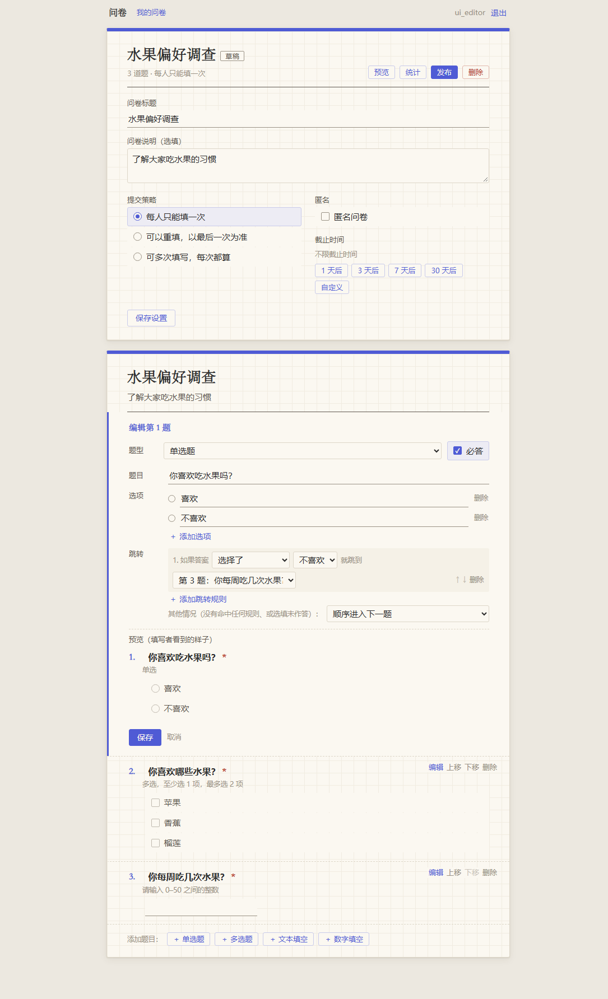 |
| 多选题“至少选 5 项”（只有 3 个选项） | 错误列在表单上方，对应输入框标红 | 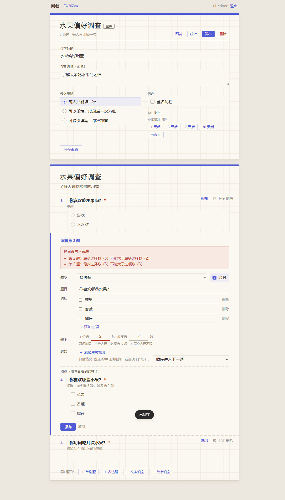 |
| 调整顺序使规则变成往前跳 | 被拒绝，错误标在对应题目上 | 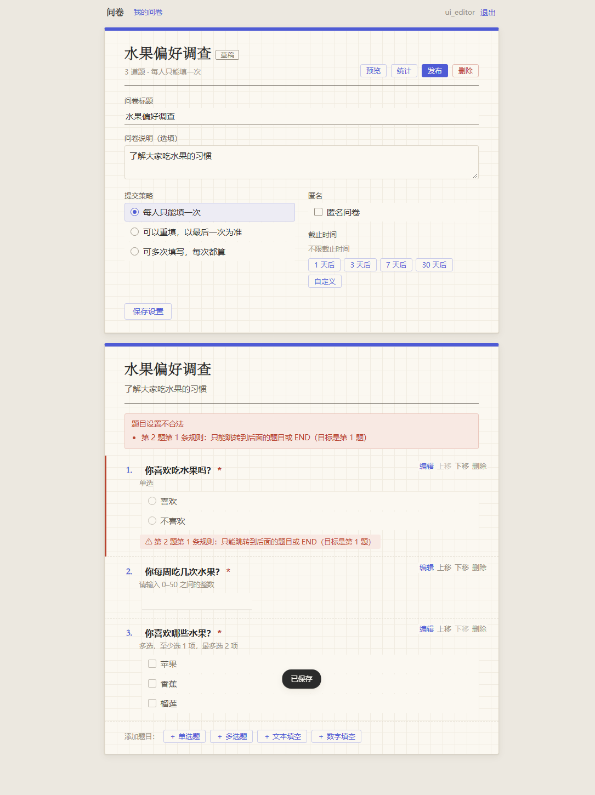 |
| 添加文本题、发布、手机尺寸 | 发布后题目只读、提交策略和匿名锁定；手机尺寸正常 | — |

### K2. 填写页（15 步，全部通过）

| 步骤 | 期望 | 截图 |
|---|---|---|
| 未登录打开问卷链接 | 跳到登录页并提示；登录后自动回到原问卷 | 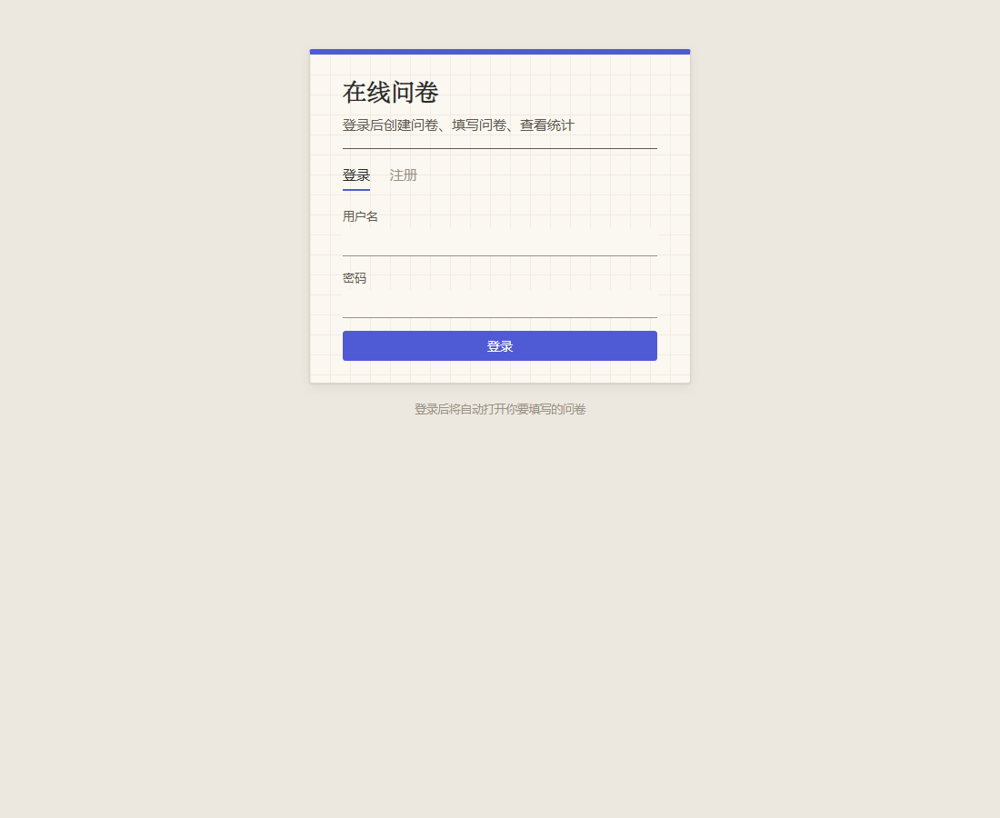 |
| 选“不喜欢” | 单选立即计算，跳到第 5 题；第 2~4 题不显示，题号保持原编号 |  |
| 改回“喜欢”、多选选了榴莲 | 第 5 题收起、第 2 题出现；多选停顿后进入第 3 题 | — |
| 第 3 题只填“好吃” | 错误显示在题目下方，题目边框变红 | 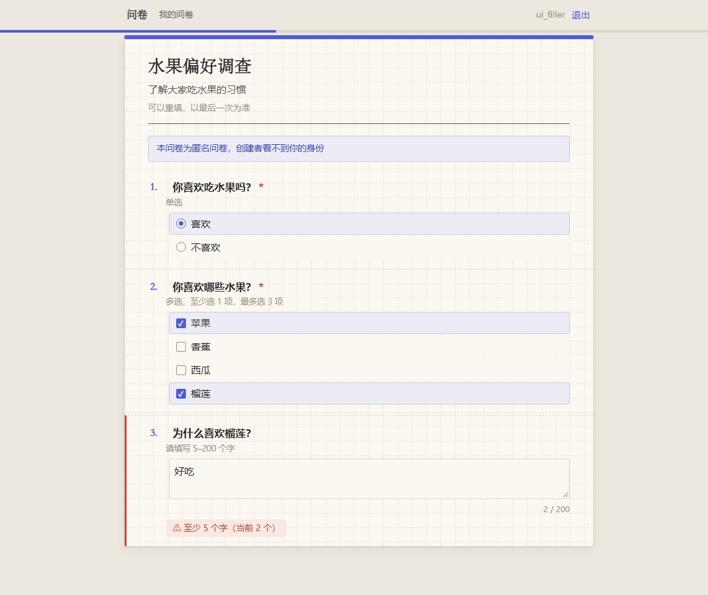 |
| 第 4 题填 0 | 结束问卷，第 5 题不显示，出现“提交”，进度 100% | 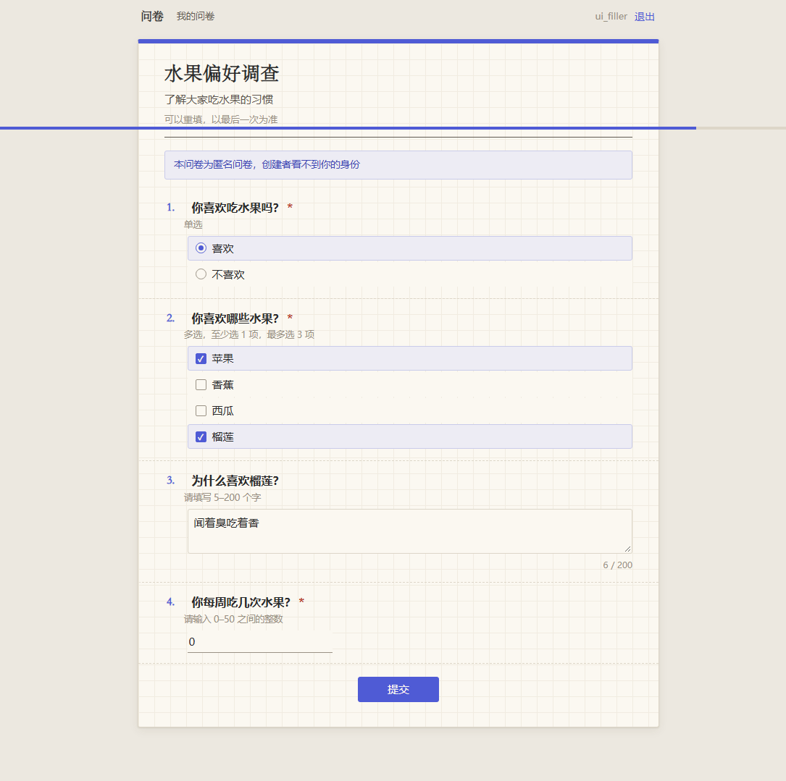 |
| 改成 7、跳过第 5 题；取消再选回榴莲 | 第 5 题出现、可“跳过此题”；第 3 题收起后恢复原内容 | — |
| 先发出的预览请求故意延迟 1.2 秒返回 | 页面只采用最后一次请求的结果 | — |
| 提交 | 感谢页；数据库只保存路径上作答的题；匿名问卷答卷列表不含填写人 | 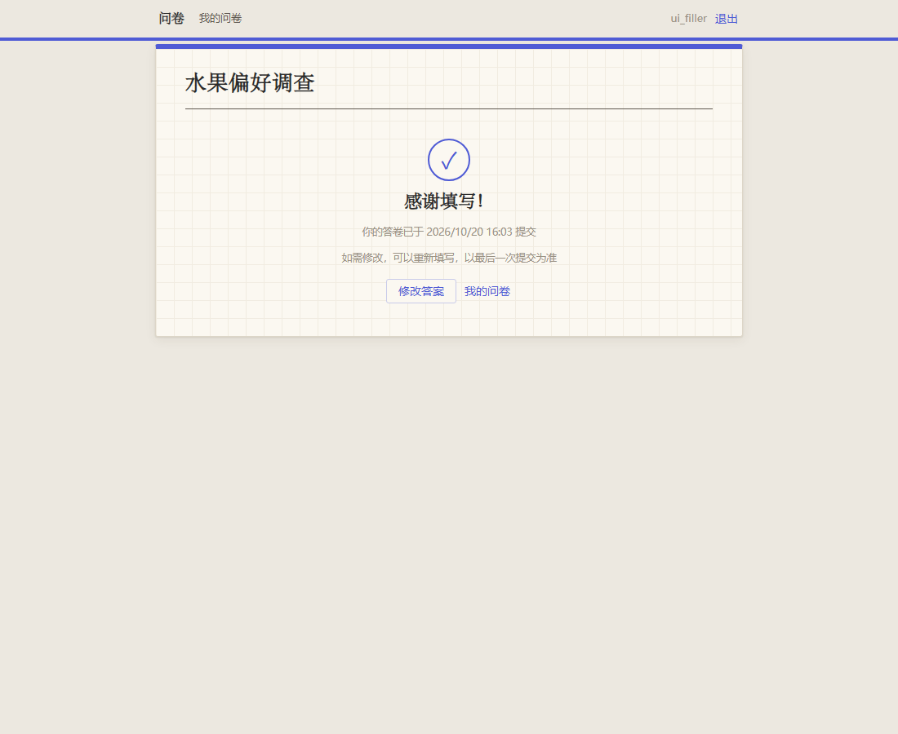 |
| 再次打开（latest） | 预填上次答案并直接展开到上次答过的位置 | 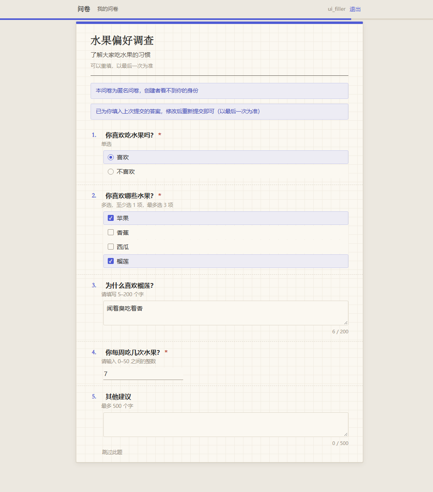 |
| 问卷关闭后打开 | 只显示“问卷已关闭”提示，不显示题目 | 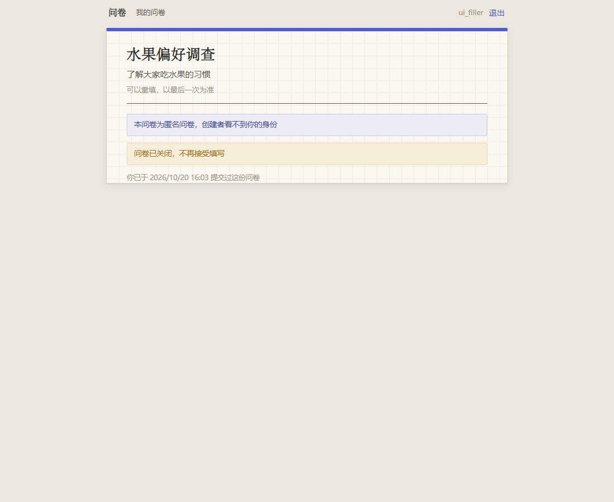 |
| 创建者预览草稿、手机尺寸 | 可以预览跳转，提交按钮禁用；手机尺寸正常 | — |

### K3. 统计页（7 步，全部通过）

固定数据：4 人按不同路径填写，其中 1 人又提交 22 次，共 26 份答卷（all 策略）。

| 步骤 | 期望 | 截图 |
|---|---|---|
| 打开统计页 | 答卷数 26、填写人数 4；“喜欢 3 人（11.5%）、不喜欢 23 人（88.5%）”；同题各选项底槽等宽；平均值 3.33；实名显示用户名 |  |
| 第 5 题加载更多 | 先显示 20 条，加载后 24 条 | — |
| 答卷列表 | 从新到旧，选项显示为文字，加载更多后 26 份 | 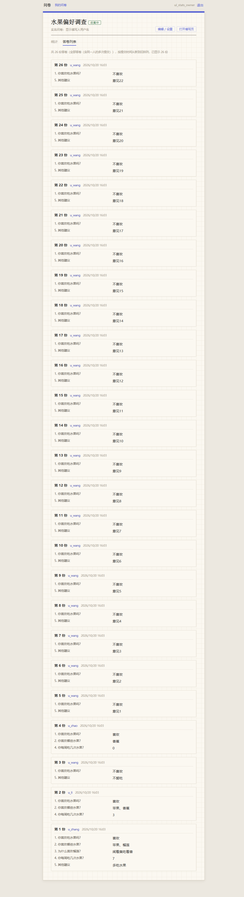 |
| 匿名问卷 | 统计和答卷列表中都不出现填写人 | 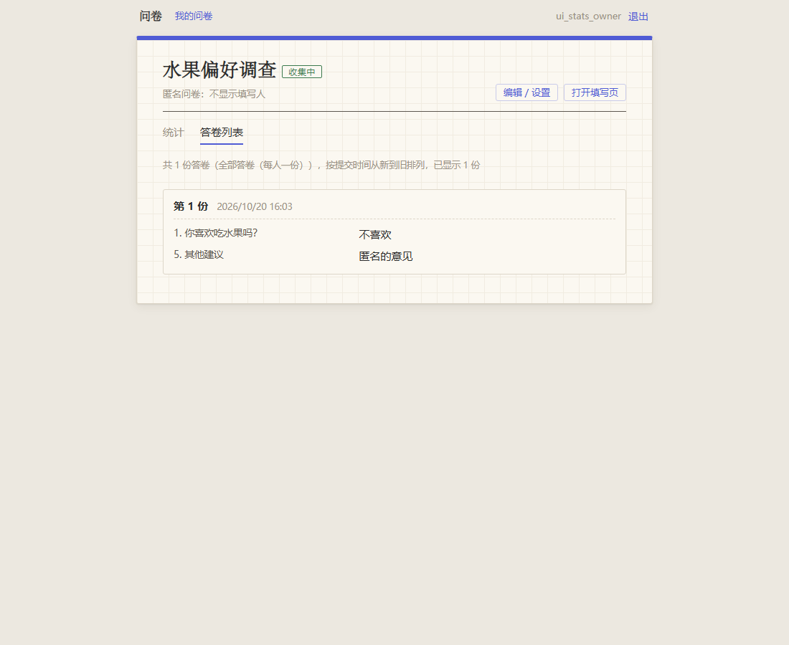 |

## 六、手工测试

开发者在每个前端小步完成后，按检查清单在浏览器中操作（Windows 11，Chrome），结果如下。

| 编号 | 内容 | 检查清单要点 | 结果 |
|---|---|---|---|
| M1 | 9a 登录、我的问卷 | 注册登录、字段错误、新建问卷、链接复制、退出、未登录访问链接后回到问卷、`next` 指向外部网站时不跳转、手机视图 | 功能通过；开发者对第一版样式不满意，提出 10 条修改要求后重做，确认满意（AI_LOG 第 22、23 条） |
| M2 | 9b 编辑页 | 四种题型、选项与校验、跳转规则、错误提示、往前跳被拒、重叠警告、发布后只读、两个标签页编辑冲突、手机视图 | 开发者确认“9b 检查通过” |
| M3 | 9c 填写页 | 逐题展开、修改后收起与恢复、错误提示、感谢页、latest 修改答案、未登录跳转、手机视图 | 开发者确认“9c 检查通过” |
| M4 | 9d 统计页 | 柱状条、百分比、平均值、答卷列表选项显示为文字、匿名问卷不显示用户名、手机视图 | 开发者确认“9d 检查通过” |
| M5 | 接口文档页 `/docs` | 注册、登录、Authorize、`/me`、创建问卷、无题目发布、JSON 格式错误提示 | 开发者手动测试通过；发现 JSON 格式错误时 `field` 显示为字符位置的问题，已修正（AI_LOG 第 15 条） |
